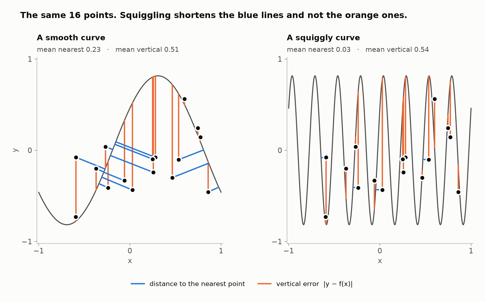
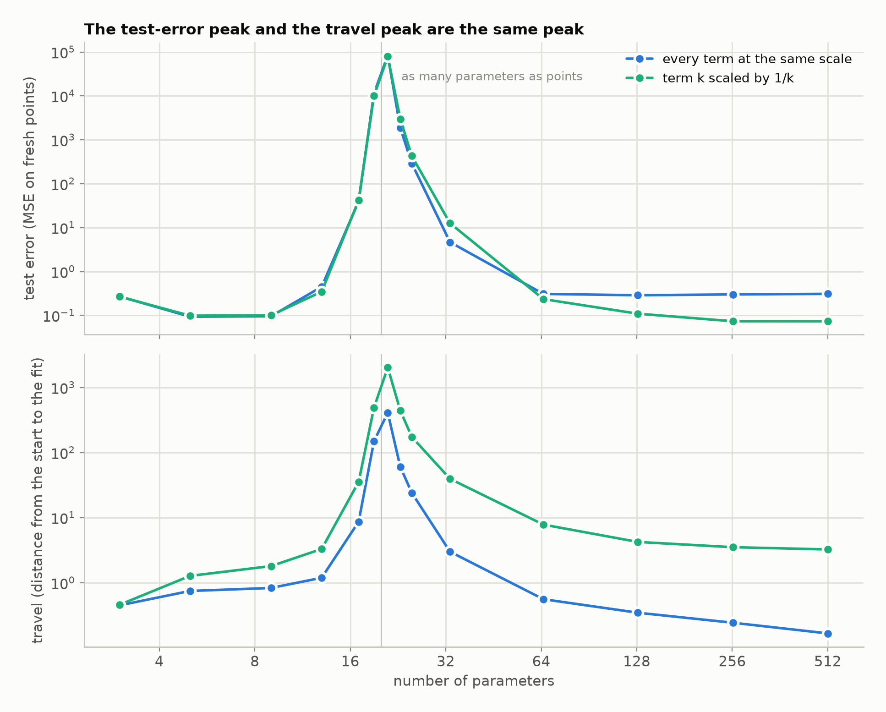
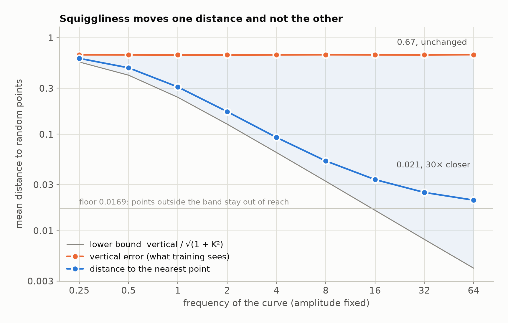
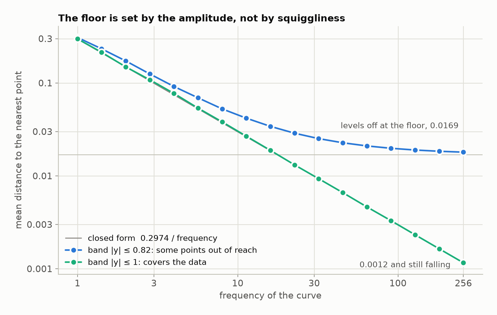
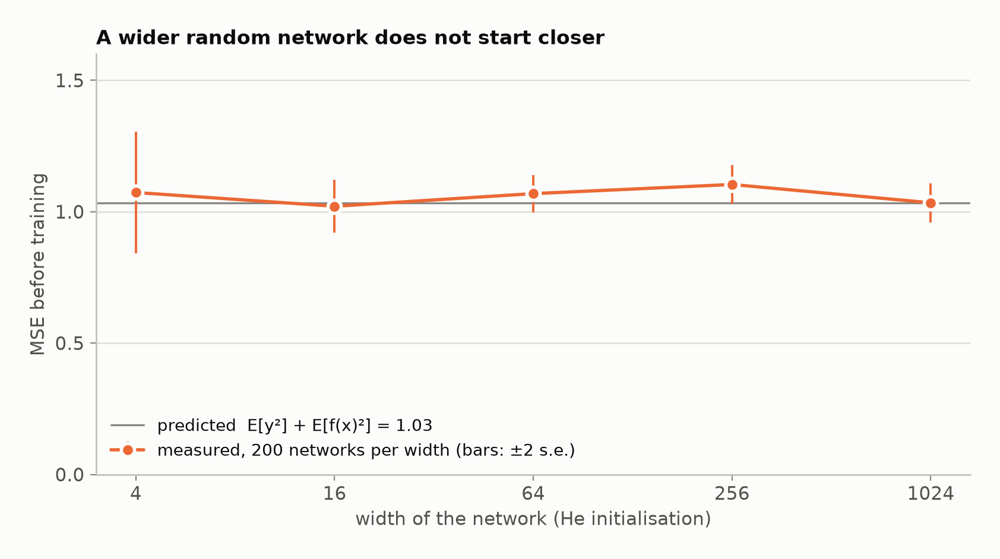

# The Squiggly Line Theorem

An idea from 2022 about why large neural networks learn fast, the experiments
that tested it, and a Lean formalisation of what turned out to be provable.

**Verdict:** the picture is geometrically true, and it does not mean what it
was meant to. A squigglier curve passes nearer to the data, but the loss at the
start does not see that. What the nearness buys is a short distance to move,
not a head start in loss.

- Write-up: [ad-absurdum.me/blog/squiggly-line-conjecture](https://ad-absurdum.me/blog/squiggly-line-conjecture)
- Slides: [2026 deck](https://docs.google.com/presentation/d/1xFoVq8pzuHHCICbLZh_NTZbHF80gQJMp8VbFF8Pzskc/edit?usp=sharing), [original deck](https://docs.google.com/presentation/d/1hucbKOalHq7g2sTdvyAnd1pDTRlAkg48H2wFui5UQTg/edit?usp=sharing)
- Full findings: [`docs/RESOLUTION.md`](docs/RESOLUTION.md)
- Paper (draft of 11 Nov 2026): [`paper/main.pdf`](paper/main.pdf)
- Proofs: [`lean/`](lean), checked on every push [](https://github.com/Ghost---Shadow/squiggly-line-theorem/actions/workflows/lean.yml)

> **Looking for an arXiv endorsement.** I would like to post the paper on arXiv
> and I am not affiliated with an institution, so I need an endorsement for
> `cs.LG`. If you are an arXiv endorser and are willing to look at it, please
> open an issue on this repository or write to the address on the first page
> of the paper.

## Citing

```bibtex
@misc{nanda2026squiggly,
  title        = {The Squiggly Line Theorem},
  author       = {Nanda, Souradeep},
  year         = {2026},
  howpublished = {\url{https://github.com/Ghost---Shadow/squiggly-line-theorem}},
  note         = {Preprint, with machine-checked proofs in Lean 4}
}
```

GitHub's "Cite this repository" button gives the same entry in other formats
(from [`CITATION.cff`](CITATION.cff)).

## The theorem

**Closer, steeper, and no better at the start.** Take any function, of any
number of inputs, and squeeze it sideways by a factor `w`, so that every wiggle
is `w` times narrower. Then:

1. **Closer.** If the function reached every label within a distance `ρ` of
   every input, the squeezed one is within `ρ / w` of every data point.
2. **Steeper.** Its slope is `w` times larger, and its distance to a data point
   is at least `vertical / √(1 + (w·K)²)`.
3. **No better at the start.** If the function is random with the same
   distribution of outputs at every input, squeezing it leaves the expected
   loss unchanged, for every regression loss.
4. **A small shift cashes it in.** Any target is fitted exactly after moving
   each input by at most `ρ / w`.

So the nearness is real and training can use it, by moving the input. It is a
distance to move, not a lower loss at the start, and its price is slope.

This is `squiggly_line_theorem_general` in
[`lean/SquigglyLine/Compression.lean`](lean/SquigglyLine/Compression.lean),
machine-checked with no `sorry`. A sine with a random phase is the standard
example (`squiggly_line_theorem`, with `ρ / w = π / w`). Plain-language
accounts are in [`docs/general-theorem.md`](docs/general-theorem.md) and
[`docs/phase-matching.md`](docs/phase-matching.md).

**For networks.** The first two claims hold for a constructed ReLU family: `L`
layers of two neurons draw a curve that passes within `1 / 2^L` of every point
of the unit square (`nearestDist_iterate_tent_le`). A network with one neuron
per layer never turns at all. A chain of polarizers, which is a network of
linear layers, delivers its target with an error of at most `π² / (8N)` after
`N` plates. What is still open is the claim for networks with **random**
weights; [`docs/open-problems.md`](docs/open-problems.md) says what it reduces
to.



## The idea

Scatter random points on a plane. Draw two curves without looking at the
points: one smooth, one squiggly. The squiggly one will pass closer to the
points on average, because it visits more of the plane.

A network computes a function, and the graph of that function is such a curve.
The conjecture said that a network with more parameters is a squigglier curve
at initialisation, so it starts closer to its data, so it learns faster.

That is three claims in a chain:

| # | Claim | Status |
|---|---|---|
| 1 | **Geometry.** A squigglier curve has a smaller mean distance to the nearest point of the curve. | True. Proved for any squeezed function, with a rate. |
| 2 | **Parameters.** More parameters give a squigglier random function. | False for width with random weights; depth adds a little. True for a constructed ReLU family. |
| 3 | **Learning.** A smaller nearest-point distance means a smaller training loss at the start. | False. Proved. |

## Why it fails

The conjecture measures the distance from a data point `(x, y)` to the nearest
point of the curve. Regression measures the vertical error `|y − f(x)|`. These
are different, and four short results say how.

**1. The slope sandwich.** If `f` is `K`-Lipschitz, then at every data point

```
vertical / √(1 + K²)  ≤  nearest  ≤  vertical
```

The curve can be much nearer than its vertical error only if it is steep.
Squiggliness buys nearness with slope and with nothing else. A small
nearest-point distance means that a small change of the *input* reaches the
label, which describes a fragile function, not a well-fitted one.

**2. The marginal lemma.** The expected loss of a random function depends only
on the distribution of `f(x)` at each single `x`. How `f` moves between two
inputs, which is what "squiggly" means, does not enter. So no experiment on
the mean initial loss can detect squiggliness.

**3. The tube identity.** The mean distance from a random point to a set `S` is
the mass outside the tube of radius `r` around `S`, integrated over `r`:

```
E[dist(P, S)] = ∫₀^∞ P(P is outside the tube of radius r) dr
```

A tube around a curve of length `l` has area at most about `2·l·r`. So in a
region of area `V` the mean distance is at least about `V / (4·l)`, with
equality only when the curve is spread evenly. Length inside the data region
is necessary for coverage and is not sufficient.

**4. Width does not change the start.** Under He initialisation the second
moment of the output is the same at every width, so the expected initial MSE
is `E[y²] + E[f(x)²]` at every width.

Results 1 to 3 are proved in Lean (see [the formalisation](#the-formalisation)).
The bound in result 3 and result 4 are derivations checked by the scripts below.

## The conjecture, un-conjectured

"More parameters, closer to the data" is not one claim that is true or false.
It reduces to one property of the function, and that property can be checked
family by family.

Say that `f` **covers the labels within `ρ`** when, near every input, some
input at distance at most `ρ` is sent to any label you ask for. The smallest
such `ρ` is the oscillation scale of `f`: how far you must walk along the input
to see every label. Then, at every data point with a label in range:

```
vertical / √(1 + K²)  ≤  nearest  ≤  ρ
```

So a shrinking oscillation scale is enough to bring the function close to the
data, and a growing slope `K` is required for it. Parameter count does not
enter except through these two quantities. (The first is sufficient and the
second is necessary. That a small distance forces a small oscillation scale is
not proved.)

**Sines: settled.** A sine of frequency `w` covers its band within `π / w`, so

```
vertical / √(1 + (A·w)²)  ≤  nearest  ≤  π / w
```

at every data point and every phase. Both ends fall like `1 / w`. Put next to
the marginal lemma, this gives the whole story as one theorem
(`closer_but_no_better`): as the frequency grows, the expected nearest-point
distance tends to zero, and the expected loss, for every regression loss, does
not change at all.

**Networks.** For chosen weights the answer is yes: `L` folding layers of two
neurons have oscillation scale `1 / 2^L`, so the curve is within that of every
point of the unit square (`TentCloser.lean`). For random weights the question
is open, and it is now precise: how does the oscillation scale of a random
network depend on width, depth and weight scale? A family whose slope stays bounded cannot get closer than
`vertical / √(1 + K²)`, however many parameters it has. Hanin, Jeong and Rolnick's result (expected
length does not grow at He initialisation) points to "no" for width. That step
is not formalised here.

## Where "more parameters" does help

The sine family has one random number, so it cannot test a claim about
parameter count. [`scripts/fourier_params.py`](scripts/fourier_params.py) uses
a family where the count is the only dial: a Fourier series with `m` terms and
random coefficients, scaled so that the output has the same variance at every
`m`. 20 points with random labels; a fit of all points exists once there are
20 parameters.

| parameters | initial MSE | nearest-point distance | travel to a fit | gradient-descent steps |
|---|---|---|---|---|
| 9 | 0.65 | 0.229 | no fit | never |
| 21 | 0.65 | 0.128 | 448 | 188 000 000 |
| 25 | 0.64 | 0.110 | 35.5 | 79 300 |
| 65 | 0.71 | 0.056 | 1.61 | 166 |
| 129 | 0.66 | 0.027 | 0.48 | 13 |
| 513 | 0.63 | – | 0.23 | 3 |

"Travel" is the distance in parameter space from the random start to the
nearest parameter vector that fits every point. "Steps" is plain gradient
descent to an MSE of 0.001 with the largest stable step size.

So a larger random model does start closer to a trained one, and it trains in
far fewer steps. But the closeness is in parameter space. The initial loss is
the same at every size (0.63 to 0.71, sampling noise around 2/3), as the
marginal lemma requires. The nearest-point distance also falls, like
`1/parameters`, because these random series get steeper as terms are added.
The worst case is right at the threshold, 21 parameters for 20 points, which
is where double descent has its peak.

This is the form in which the original idea is true: more parameters put a
solution nearer to the random start. It is the known lazy-training picture,
not a new result.

The link between the two kinds of "close" is that the loss gap equals distance
times steepness. On the straight path from the start to a fit, the loss is
`(1 − t)²` times the initial loss at every model size. A bigger model walks the
same curve over a shorter path. So at a movement budget of zero it is no
closer to the data, and at any positive budget it is. The path identity and
"more parameters never move the fit away" are proved in Lean
(`LinearModel.lean`).

Far above the threshold the two kinds of "close" are the same quantity at an
exchange rate. With `m` terms and `n` points the features are nearly
orthogonal, each with squared length `m + 1`, so

```
travel ≈ √(n × initial MSE / (m + 1))
```

This gives 0.45, 0.32 and 0.22 for 129, 257 and 513 parameters, against 0.48,
0.34 and 0.23 measured. Parameter distance is the root of the loss, divided by
a factor that grows like the root of the parameter count. At exactly `n`
orthonormal features the factor is 1 and the two are equal. Near the threshold
the features are far from orthogonal and the travel is much larger than this.
The exact version is a Lean theorem (`ExchangeRate.lean`): when the features
are exactly orthogonal on the data side with squared length `c`, the travel is
`‖residual‖ / √c`. That random Fourier features are nearly so, with
`c = m + 1`, is checked by the experiment and not proved.

## Double descent

The 2022 deck said the picture ties in with double descent and derived
nothing. [`scripts/double_descent.py`](scripts/double_descent.py) fits the same
Fourier model to 20 noisy points and scores it on fresh ones.

| parameters | test error | travel to the fit |
|---|---|---|
| 5 | 0.094 | 0.75 |
| 13 | 0.45 | 1.2 |
| 21 | 83 800 | 409 |
| 33 | 4.7 | 3.0 |
| 65 | 0.31 | 0.56 |
| 513 | 0.31 | 0.17 |



The test error falls, peaks where the model has as many parameters as points,
and falls again. The travel peaks at the same place. Two proved facts connect
them (`DoubleDescent.lean`):

- A fit that is near the start stays near the starting function everywhere,
  within the size of the features times the travel.
- The travel is at most the size of the labels divided by `√c`, where `c` is
  the weakest direction of the kernel. At the threshold `c` is 0.00000007. At
  513 parameters it is 202.

The peak itself is exact for a single direction of the labels. If the kernel
stretches that direction by `λ`: with `λ = 0` no fit exists and the model
leaves it alone; with `λ > 0` the travel is exactly its size divided by `√λ`,
which grows without bound as `λ` shrinks. Being unable to fit the noise is
safe, being barely able to is the worst case, and being easily able to is safe
again.

So the second descent is the same fact as "a bigger model starts nearer to a
fit", and the peak is where the fit is furthest away. That the test error
peaks there is measured, not proved. How low the second descent goes depends
on which terms are cheap: with every term at the same scale it ends at 0.31,
the error of predicting zero; with term `k` scaled by `1/k` it ends at 0.073,
below the first minimum. Details are in
[`docs/double-descent.md`](docs/double-descent.md).

## The evidence

### Frequency, with everything else held fixed

[`scripts/frequency_isolation.py`](scripts/frequency_isolation.py) uses sines
of one fixed amplitude and a random phase. Only the frequency changes.

| frequency | arc length | nearest-point distance | vertical error |
|---|---|---|---|
| 0.25 | 2.19 | 0.6129 | 0.6672 |
| 1 | 3.96 | 0.3095 | 0.6649 |
| 4 | 13.32 | 0.0928 | 0.6663 |
| 16 | 52.31 | 0.0338 | 0.6665 |
| 64 | 208.92 | 0.0207 | 0.6688 |



The nearest-point distance falls by a factor of 30. The vertical error does not
move. The second fact is the marginal lemma: a random phase gives `f(x)` the
same distribution at every frequency, so the column is flat by construction and
the small differences are sampling noise.

The distance stops falling at 0.0169 because the sine sweeps only the band
`|y| ≤ 0.816`, and points outside the band stay out of reach. With an amplitude
that covers the data there is no floor, and the distance follows
`0.2974 / frequency`. The constant is `(2 − 8/π²) / 4`, derived in
`docs/RESOLUTION.md` §6 and confirmed by
[`scripts/saturation_scaling.py`](scripts/saturation_scaling.py). Distance
times arc length tends to 1.19, a little above the 1.0 of an evenly spread
curve, because the strokes of a sine are not evenly spaced.



### A straight line of the same length

| frequency | arc length | sine | straight line, same length |
|---|---|---|---|
| 4 | 13.32 | 0.0928 | 0.5022 |
| 16 | 52.31 | 0.0338 | 0.5007 |
| 64 | 208.92 | 0.0207 | 0.5006 |

Read this table with care. A straight line of length 209 over `x ∈ [−1, 1]` has
slope 104, and about 99% of it lies above or below the data. So the table
shows that length outside the data region is worth nothing. It does not show
that length is irrelevant: by result 3, length inside the region is required.

### Random networks

[`scripts/initial_mse.py`](scripts/initial_mse.py): 10 inputs, 200 points, two
hidden layers, 200 untrained ReLU networks per width.

| width | 4 | 16 | 64 | 256 | 1024 |
|---|---|---|---|---|---|
| He initialisation, measured | 1.07 | 1.02 | 1.07 | 1.10 | 1.03 |
| He initialisation, predicted | 1.03 | 1.03 | 1.03 | 1.03 | 1.03 |
| Unscaled weights, measured | 15 | 220 | 3 450 | 60 200 | 823 000 |



A wider network does not start closer. With unscaled weights it starts much
further away, because the output grows with width. That growth is the
amplitude effect that made the first experiments in this repository look like
support for the idea.

[`scripts/random_relu_length.py`](scripts/random_relu_length.py) looks at the
curves themselves, for a 1-D input: width does not add arc length (3.4 to 3.6
from width 2 to 512), and depth adds some (3.4 to 5.1 from 1 to 16 layers).

## The formalisation

[`lean/`](lean) is a Lean 4 project on Mathlib. It states the conjecture and
proves the results above. There is no `sorry`, and each theorem depends only on
Lean's three standard axioms.

| File | Contents | Status |
|---|---|---|
| [`Defs`](lean/SquigglyLine/Defs.lean) | the curve, the data, the two costs | definitions |
| [`RandomFunction`](lean/SquigglyLine/RandomFunction.lean) | a randomly initialised model, its marginals, its expected cost | definitions |
| [`Conjecture`](lean/SquigglyLine/Conjecture.lean) | the conjecture and the learning claim | stated, not proved |
| [`Sandwich`](lean/SquigglyLine/Sandwich.lean) | `vertical / √(1 + K²) ≤ nearest ≤ vertical` | proved |
| [`Coverage`](lean/SquigglyLine/Coverage.lean) | the tube identity | proved |
| [`Marginal`](lean/SquigglyLine/Marginal.lean) | a regression loss sees only one-point marginals | proved |
| [`RandomPhase`](lean/SquigglyLine/RandomPhase.lean) | frequency does not change the marginals of a random-phase wave | proved |
| [`Verdict`](lean/SquigglyLine/Verdict.lean) | the learning claim fails for random-phase sines, for every regression loss and every data distribution | proved |
| [`Oscillation`](lean/SquigglyLine/Oscillation.lean) | `nearest ≤ ρ` when `f` covers the labels within `ρ`, and the slope this costs; any target with labels in range is fitted exactly after a warp of the input of size at most `ρ` | proved |
| [`SineCloser`](lean/SquigglyLine/SineCloser.lean) | for sines, `vertical / √(1 + (A·w)²) ≤ nearest ≤ π / w`; the expected distance tends to zero while the loss stays fixed | proved |
| [`SquigglyLineTheorem`](lean/SquigglyLine/SquigglyLineTheorem.lean) | the four statements above, collected into one theorem | proved |
| [`LinearModel`](lean/SquigglyLine/LinearModel.lean) | for models linear in their parameters: on the path to a fit the residual shrinks in proportion, so a movement of `ε` buys the fraction `ε / d` of it; adding parameters never moves the nearest fit further away | proved |
| [`ExchangeRate`](lean/SquigglyLine/ExchangeRate.lean) | when the features are orthogonal on the data side with squared length `c`: the distance to the nearest fit is exactly `‖residual‖ / √c`; with orthonormal features it equals the residual | proved |
| [`NarrowChain`](lean/SquigglyLine/NarrowChain.lean) | a ReLU network with one neuron per layer never turns, at any depth | proved |
| [`Polarizer`](lean/SquigglyLine/Polarizer.lean) | in the plane ReLU sends a point to the nearest point of the positive quadrant; a rotate-then-ReLU layer keeps `cos θ` of a bird on the edge for a turn up to 90° and blocks it beyond; `N` small turns keep `cos θ ^ N`, and a half turn in `N ≥ 3` steps keeps at least `1 − π²/(2N)` | proved |
| [`Depth`](lean/SquigglyLine/Depth.lean) | `L` layers of two neurons make a curve that alternates 0, 1, 0, 1 on `2^L + 1` evenly spaced inputs: `2^L − 1` turns | proved |
| [`Bridge`](lean/SquigglyLine/Bridge.lean) | one fold doubles a frequency: `sin²(π/2 · tent^L(x)) = sin²(2^L · π/2 · x)` on `[0, 1]`, so `L` folds seen through a fixed lens are one Fourier term of frequency `2^L` | proved |
| [`Kernel`](lean/SquigglyLine/Kernel.lean) | for models linear in their weights: a gradient step sends the error `r` to `r − η·K·r`; the travel is the length of `A†K⁻¹r`; two models with the same kernel have the same training path and the same travel | proved |
| [`ThreePolarizers`](lean/SquigglyLine/ThreePolarizers.lean) | Malus's law for a polarizer as a projection; crossed plates block; after `k` plates each turned by `θ` the light has length `cos(θ)^k` and angle `k·θ`; a 45° plate between crossed ones passes half the length; a quarter turn in `N ≥ 2` plates delivers at least `1 − π²/(8N)` | proved |
| [`MarkovChains`](lean/SquigglyLine/MarkovChains.lean) | through the layers: merged stays merged, the flock never occupies more places, dead stays dead; the photon as a two-state chain, alive after `n` plates with probability `cⁿ`; through training with orthogonal features: the error after `t` steps is `(1 − η·c)ᵗ` times the start, and a step of size `1/c` fits at once | proved |
| [`Compression`](lean/SquigglyLine/Compression.lean) | the theorem for any function: squeezing by `w` divides the oscillation scale by `w`, multiplies the slope by `w`, and leaves the marginals of a random function with homogeneous marginals unchanged | proved |
| [`TentCloser`](lean/SquigglyLine/TentCloser.lean) | `L` two-neuron ReLU layers pass within `1 / 2^L` of every point of the unit square | proved |
| [`DoubleDescent`](lean/SquigglyLine/DoubleDescent.lean) | a fit near the start is tame everywhere; the travel is at most `‖residual‖ / √c` when the kernel is at least `c` in every direction; along a direction of strength `λ` no fit exists if `λ = 0` and the travel is exactly `‖residual‖ / √λ` if `λ > 0`; for one training point the kernel is the squared length of the feature vector | proved |
| [`Dimple`](lean/SquigglyLine/Dimple.lean) | the dimpled manifold: a function that is `g` along the data manifold and has slope `K` across it has the loss of `g` on real data for every `K`, reaches any label by a step of `error / K` straight off the manifold, and has nearest-point distance between `vertical / √(1 + (L + K)²)` and `vertical / K` | proved |
| [`LeastAction`](lean/SquigglyLine/LeastAction.lean) | least action: gradient descent moves only along the features, so any fit it arrives at is the nearest one to the start; and two turns `a`, `b` never keep more than two turns of their average, so the evenest path through the layers loses least | proved |

Both halves of the conjecture are one definition, `StartsCloser cost M μ`: the
expected cost falls strictly as the model grows. The conjecture uses the
nearest-point distance as the cost. The learning claim uses a regression loss.
`Verdict.lean` refutes the second for the sine family of the experiment:

```lean
theorem not_learningClaim_sineWave (A : ℝ) (hℓ : Measurable ℓ) (frequency : ℕ → ℝ)
    (μ : Measure (DataPoint ℝ)) : ¬ LearningClaim ℓ (fun m => sineWave A (frequency m)) μ
```

Not formalised: the exact constant `0.2974` for sines, the bound `V / (4·l)`,
the rate at which travel falls with parameter count (about `1/√parameters`),
that the test error peaks at the threshold, and the statements about networks
with random weights.

To build (the first build downloads Mathlib):

```bash
cd lean
lake exe cache get
lake build
```

`lake build` passes with Lean 4.36.0-rc1 and the Mathlib commit pinned in
[`lean/lake-manifest.json`](lean/lake-manifest.json).

## Running the experiments

```bash
pip install -r requirements.txt
cd scripts

python frequency_isolation.py    # the main experiment, ~10 s
python saturation_scaling.py     # what sets the floor, several minutes
python initial_mse.py            # random networks at five widths, ~1 min
python fourier_params.py         # what adding parameters changes, ~1 min
python double_descent.py         # test error and travel against model size, ~1 min
python random_relu_length.py     # arc length of random ReLU curves
python audit_legacy_metrics.py   # reproduces the defects listed below
python readme_figures.py         # redraws the figures on this page, ~2 min
```

## Repository layout

| Path | Contents |
|---|---|
| `docs/RESOLUTION.md` | the findings in full |
| `docs/EXPERIMENT_LOG.md` | a re-run of every script, 19 Sep 2026, with raw output |
| `docs/literature-survey.md` | related work |
| `docs/wind-tunnel-and-polarizers.md` | the ReLU picture in plain words: resolving power, the tunnel that cannot turn, ReLU as a polarizer |
| `docs/fourier-parameters.md` | what adding parameters changes, in plain words: the Fourier-series family, travel, and the exchange rate |
| `docs/fourier-and-relu-bridge.md` | how the Fourier model and the ReLU wind tunnel relate: a fold doubles a frequency, a model is its kernel, and where the two differ |
| `docs/phase-matching.md` | how training can use the nearness: a shift for one point, a warp for many, and what it costs |
| `docs/general-theorem.md` | the theorem without the sines: squeezing any function, and a ReLU family for which the conjecture is true |
| `docs/double-descent.md` | double descent as the travel peak |
| `docs/three-polarizers.md` | the three-polarizer experiment in plain words, and why the photon's path is a squiggly line |
| `docs/chain-of-markov-chains.md` | training as a chain through the layers inside a chain through the steps, and what having no memory costs |
| `docs/open-problems.md` | twenty problems this repository leaves open, each marked open, known but not formalised, or measured |
| `docs/least-action.md` | the trained path as a path of least action: the nearest fit, and the evenest route through the layers |
| `docs/dimpled-manifold.md` | the dimpled manifold hypothesis in this picture: the price of nearness is slope, and it can be paid off the data manifold |
| `docs/` (other) | development notes, kept as history |
| `lean/` | the formalisation |
| `paper/` | a NeurIPS-format draft of the paper |
| `scripts/curves.py` | shared sine-curve geometry, with an exact point-to-curve distance |
| `scripts/` (experiments) | the scripts listed above |
| `scripts/` (other) | the first exploratory code, kept as a record |
| `graphs/`, `diagrams/` | figures |
| `handoff.md` | open experiments, with a prediction and a stop rule for each |

## What went wrong the first time

The first scripts (August 2025) appeared to support the idea. Three of their
measurements were not what they claimed to be.
[`scripts/audit_legacy_metrics.py`](scripts/audit_legacy_metrics.py) reproduces
each one.

1. **The "distance" was a neuron count.** `utils.measure_coverage` compared the
   label with the number of active neurons, about half the width.
2. **The scaling law was the output fading.** `relu_chain.py` measured
   `‖net(x) − x‖`. Under Xavier initialisation the output shrinks as the width
   grows, so the value converged to `‖x‖`, the score of a network that returns
   nothing.
3. **The 1-D case measured against a diagonal.** One coordinate was used twice,
   which put every "random" point on the line `y = x`.

These scripts are kept unfixed, with a warning at the top of each, because the
audit depends on them. Do not cite their output.

Two later corrections were numerical. A fixed sampling grid overestimated
distances for steep curves (fixed 19 Sep 2026). The replacement still chose
the wrong stroke of the curve once the strokes were closer together than the
sample spacing, which overestimated one control by 11% at frequency 1000
(fixed 11 Nov 2026). Both are described in `docs/RESOLUTION.md` §2.

## Open questions

The full list, with a status for each, is in
[`docs/open-problems.md`](docs/open-problems.md).

The original question is answered. What remains is in
[`handoff.md`](handoff.md):

- Does a larger network travel a shorter distance in weight space to reach a
  fit? Lazy-training theory says yes, so this would be a replication.
- The mean initial loss is flat in width. Is the chance of a low initial loss
  also flat?
- Does the best subnetwork of a random network improve with width where the
  full network does not?
- Where do the kinks of a ReLU network go during training?

One more direction came out of the formal work. The nearest-point distance
scores each point alone, so it cannot see whether a function fits many points
at once. The cost of a joint fit under a random-function prior with kernel `K`
is `yᵀK⁻¹y`. For random labels its mean is `tr K⁻¹`, which at fixed amplitude
is smallest when `K` is the identity, that is, for the least correlated and
squiggliest prior. For smooth targets the order reverses. This is untested
here beyond a quick numerical check.

## License

MIT. See [`LICENSE`](LICENSE).
