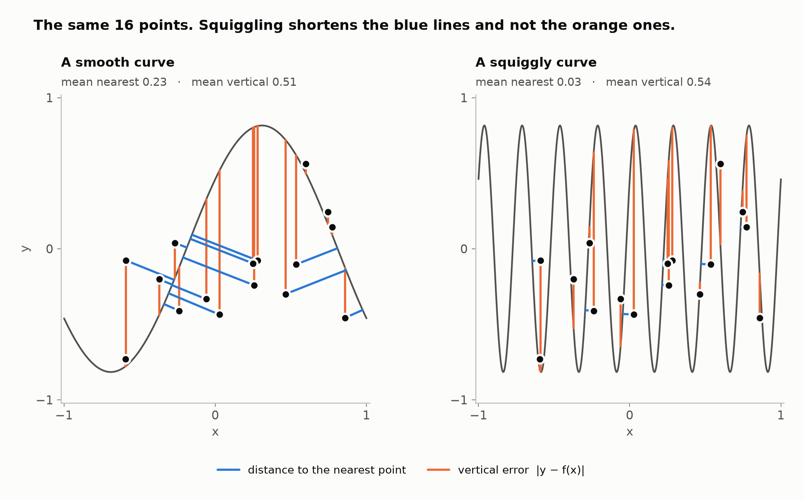
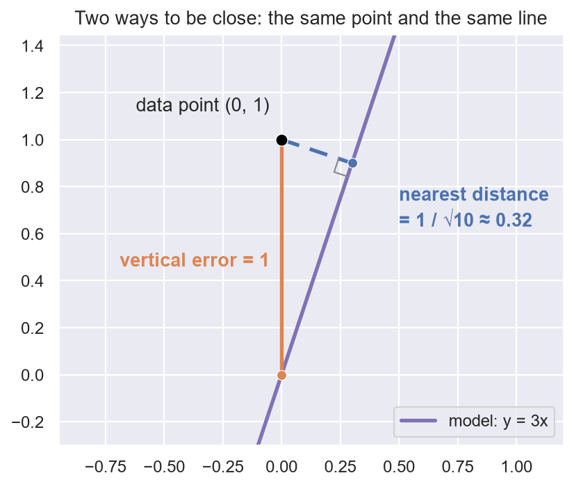

# 1. Two distances

**In the repository:**
[`Defs.lean`](../lean/SquigglyLine/Theorem/Defs.lean),
[`Conjecture.lean`](../lean/SquigglyLine/Theorem/Conjecture.lean).
**You need:** nothing.

## The picture

Scatter some points on a sheet of paper. Without looking at them, draw two
curves from left to right: one smooth, one squiggly. The squiggly one
passes closer to the points, because it visits more of the paper.

A neural network computes a function, and the graph of that function is
such a curve. The points are the training data. So here is an idea about
why big networks learn fast:

> A network with more parameters draws a squigglier curve before training.
> So it starts closer to its data. So it learns faster.

This was the squiggly line conjecture. It is three claims in a chain, and
this book is about what happens to each of them.

## Two ways to be close

"Closer to the data" can mean two different things.

- The **nearest distance** is the distance from a data point to the nearest
  point of the curve, in any direction. This is what your eye sees.
- The **vertical error** is the distance straight up or down from the data
  point to the curve. This is what training measures: the label minus the
  prediction.

**An example.** The model is the straight line `y = 3x`. The data point is
`(0, 1)`. Straight down from the point, the line is at height 0, so the
vertical error is 1. But the line is steep, and it passes much closer than
that off to the side: the nearest distance is `1 / √10`, about 0.32.

The whole theorem lives in the gap between these two numbers.

## The words the proofs use

The Lean files give each of these things a name. You will see them in
every chapter.

| Name | Meaning | In Python |
|---|---|---|
| `Model Inputs` | a function from inputs to real numbers | `Callable[[Input], float]` |
| `DataPoint Inputs` | a pair `(input, label)` | `tuple[Input, float]` |
| `GET_INPUT`, `GET_LABEL` | the two parts of a data point | `data_point[0]`, `data_point[1]` |
| `GET_GRAPH` | the squiggly line: every `(input, model(input))` | |
| `GET_NEAREST_DISTANCE` | distance from a data point to the line | |
| `GET_VERTICAL_ERROR` | `abs(label - model(input))` | |
| `GET_RESIDUAL_LOSS` | any loss that reads only `label - model(input)` | |

The names in capitals are functions and constants. Functions are verbs:
`GET_NEAREST_DISTANCE model data_point` returns a number.

## The conjecture, as three claims

| # | Claim | What happens to it |
|---|---|---|
| 1 | **Geometry.** A squigglier curve has a smaller nearest distance. | True. Chapters 4, 6 and 7. |
| 2 | **Parameters.** More parameters give a squigglier curve. | Mixed. True for depth, chapter 8. Open for random weights, chapter 47. |
| 3 | **Learning.** A smaller nearest distance means a smaller loss at the start. | False for any loss that reads one input at a time, on average over the random start. Chapter 5. |

So the picture is right and the conclusion is wrong. The nearness is real,
but the loss cannot see it. What the nearness does buy is a short distance
to move, and chapter 9 measures that distance.

## What the nearness does buy: the warp

The loss cannot see the nearness, but a small move can use it. Say you
want the model to output a target at every input. Instead of changing the
model, change where you read it. The **warp** sends each input to a nearby
input at which the model already outputs what the target wants there. A
model that passes near every label in position, even when it is far in
height, can be read this way.

**An example.** The model is `sin(x)` and the target is the constant `0.5`.
At input `0` the model says `0`, which is wrong by `0.5`. Move the input to
`0.5236` (that is `π / 6`) and the model says exactly `0.5`. At input `2`
the model says `0.909`. Move the input to `2.618` (that is `5π / 6`) and it
says `0.5`, a move of `0.618`. Every input has such a place within `π`, one
full wave, so no input moves further than `π`. For `sin(8x)` the waves are
eight times narrower and no move is longer than `π / 8`, about `0.39`.

So a warp is a way to move each input by at most `reach` so that the model,
read at the moved input, equals the target. Chapter 4 states it in Lean and
proves that one exists. A warp is not a new model, and the book does not
claim that training finds it.

## Run it yourself

[`ch01_two_distances.ipynb`](../experiments/part1/ch01_two_distances.ipynb)
checks this chapter in PyTorch. It measures the example (nearest distance 0.31623,
and `1 / √10` is 0.31623), the flat-line answer, and, on 1200 random points
and sine models, that the nearest distance was never larger than the
vertical error. The measurement does not use the point straight above or
below the data point as a sample, so it could have failed. This is a
check by measurement, not a proof. Chapter 3 proves it. To run all of
Part I: `jupyter nbconvert --to notebook --execute --inplace experiments/part1/ch*.ipynb`.

## Check yourself

1. The model is the flat line `y = 0` and the data point is `(2, 5)`. What
   are the two distances?
2. Can the nearest distance be larger than the vertical error?
3. Which of the two does a regression loss measure?

**Answers.** (1) Both are 5: the nearest point of a flat line is straight
below. (2) No. Straight up or down is one way to reach the curve, so the
nearest way is no longer. Chapter 3 proves it. (3) The vertical error.

Previous: [Preface](00-preface.md) · Next: [2. How to read a proof here](02-reading-a-proof.md)
