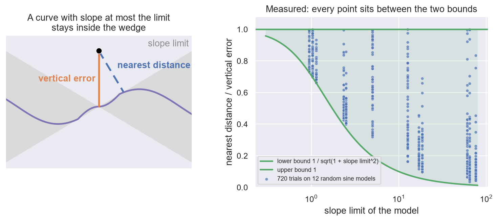

# 3. Slope

**In the repository:**
[`Sandwich.lean`](../lean/SquigglyLine/Theorem/Sandwich.lean).
**You need:** chapters 1 and 2.

## The idea

Chapter 1 had two distances, and an example where they differed: the line
`y = 3x` had vertical error 1 at the point `(0, 1)` and nearest distance
0.32. The line could pass that close only because it is steep.

This chapter makes that exact. If a model's slope is never more than
`slope_limit`, then at every data point

```
vertical_error / √(1 + slope_limit²)  ≤  nearest_distance  ≤  vertical_error
```

This is the **slope sandwich**. The right side says the curve is never
further than straight up or down. The left side says how much closer it
can be, and the answer depends on the slope and on nothing else.

**Check the example.** The line `y = 3x` has slope 3, and `√(1 + 3²)` is
`√10`, about 3.16. The sandwich says the nearest distance is at least
`1 / 3.16 = 0.32`. It is exactly that. A straight line is the case where
the left side is as tight as it can be.

**What it means.** Suppose a curve passes 100 times closer to its data
than its vertical error. Then `√(1 + slope_limit²)` is at least 100, so
the slope reaches about 100 somewhere. A curve buys nearness with slope.
There is no other currency.



## The statement

The right side of the sandwich is the theorem you read in chapter 2. This
is the left side.

```lean
/-- The vertical error is at most `√(1 + slope_limit²)` times the distance to
the line. -/
theorem verticalDist_le_of_lipschitz
    {slope_limit : SlopeLimit}
    (slope_is_bounded : LipschitzWith slope_limit model)
    (data_point : DataPoint Inputs) :
    let vertical_error   := GET_VERTICAL_ERROR model data_point
    let nearest_distance := GET_NEAREST_DISTANCE model data_point
    let stretch          := √(1 + (slope_limit : ℝ) ^ 2)  -- Pythagoras: 1 across, slope_limit up
    vertical_error ≤ stretch * nearest_distance := by
```

`LipschitzWith slope_limit model` is how Lean says "the model's slope is
never more than `slope_limit`": two outputs differ by at most
`slope_limit` times the distance between their inputs. Chapter 2 explains
this line and the bracketed `Inputs` line above it. The claim is the
left side of the sandwich with the square root moved across.

## Why it is true

**The right side.** The point of the curve directly above or below the
data point is one point of the curve. The nearest point is no further
than that one.

**The left side.** Pick any point of the curve. Say it is `across` to the
side of the data point and `up` above or below it. To go from the data
point straight to the curve, you can go to that point and then follow the
curve back to where you started sideways. Following the curve back over
a distance `across` changes its height by at most `slope_limit × across`.
So

```
vertical_error ≤ up + slope_limit × across
```

The right side is largest, for a fixed distance `√(across² + up²)`, when
the step `(across, up)` points along `(slope_limit, 1)`. That is the
Cauchy–Schwarz inequality, and it gives

```
up + slope_limit × across ≤ √(1 + slope_limit²) × √(across² + up²)
```

This holds for every point of the curve, so it holds for the nearest one.

In the Lean proof these are the `calc` chain at the end of the file and
the small lemma `add_mul_le_sqrt_mul_sqrt` just above it.

## Where it goes next

This is the most reused theorem in the repository. Eight other files call
it. Every time a later chapter says "that takes slope", this sandwich is
the reason.

## Run it yourself

[`ch03_slope_sandwich.ipynb`](../experiments/part1/ch03_slope_sandwich.ipynb)
measures the sandwich in PyTorch. For straight lines the left side is an
equality, and the measured gap from it is at most `4e-16`. For 720 trials on 12 random
sine models of 1, 3, 10 and 30 terms (the slope limit is the sum of
frequency times the size of the amplitude) and 60 random data points each, both
sides held every time. The upper side is measured without using the point
straight above or below the data point as a sample, so it could have
failed. The picture above is drawn from those 720 points.
The nearest distance is measured on a fine polyline, so the check allows
a slack of `3e-4`. This is a measurement. The Lean proof is the proof.

## Check yourself

1. A model has slope limit 0. What does the sandwich say?
2. A model has slope at most 1 and vertical error 1 at a data point. How
   close can the curve pass?
3. Near a data point the vertical error is 0.5 and the nearest distance
   is 0.005. What can you say about the slope?

**Answers.** (1) `√(1 + 0) = 1`, so the two distances are equal. A flat
line is nearest straight up or down. (2) No closer than `1 / √2`, about
0.71. (3) `√(1 + slope_limit²)` is at least 100, so the slope reaches at
least 99.99 somewhere.

Previous: [2. How to read a proof here](02-reading-a-proof.md) · Next: [4. Nearness](04-nearness.md)
