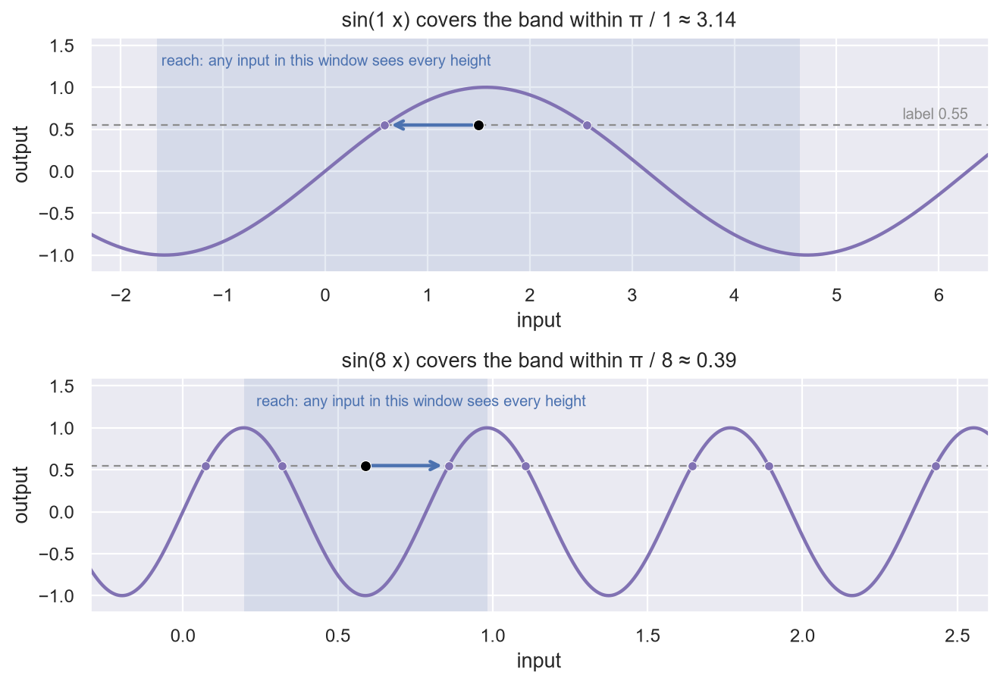
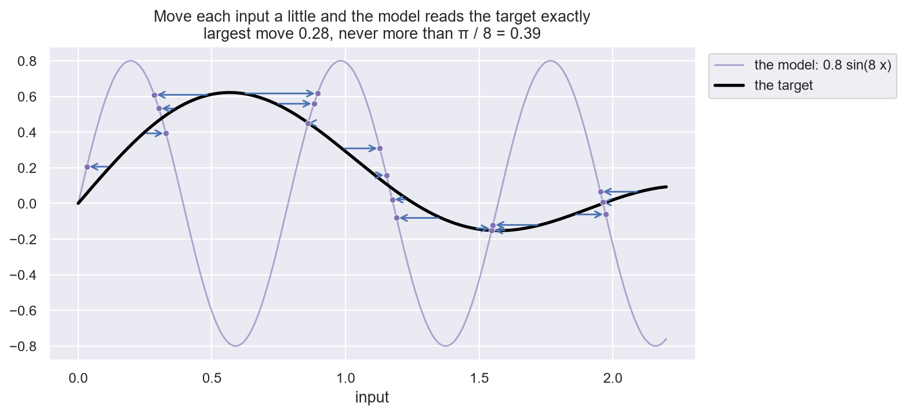
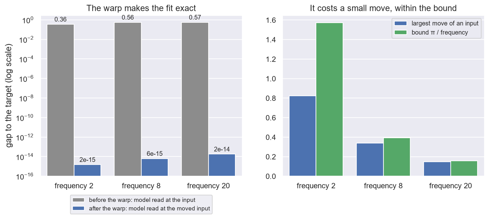

# 4. Nearness

**In the repository:**
[`Oscillation.lean`](../lean/SquigglyLine/Theorem/Oscillation.lean),
[`Coverage.lean`](../lean/SquigglyLine/Theorem/Coverage.lean).
**You need:** chapters 1 to 3.

## The idea

"Squiggly" is a picture. A proof needs a number. The number used here is
how far you have to walk sideways before the curve has passed every
height.

Say a model **covers** a range of labels **within `reach`** when this
holds: stand at any input, name any label in the range, and some input no
further than `reach` away is sent exactly to that label.

**An example.** The curve `sin(x)` goes through every height between −1
and 1 once on the way up and once on the way down, and it repeats every
`2π`. Stand anywhere. The inputs within `π` of you make up one full
wave, so every height in the band is hit. So `sin(x)` covers the band
from −1 to 1 within `π`.

Now take `sin(8x)`. Its waves are eight times narrower, so it covers the
same band within `π / 8`, about 0.39. A squigglier curve has a smaller
reach. That is the definition doing its job.

A flat line covers only its own height. A straight sloping line covers
every label, but only with a reach as large as the labels are far away.



## The definition

```lean
def COVERS_WITHIN
    (model : Model Inputs)
    (reach : ℝ)
    (label_range : Set ℝ) : Prop :=
  ∀ input, ∀ label ∈ label_range, ∃ other_input,
    let is_near        := dist input other_input ≤ reach
    let hits_the_label := model other_input = label
    is_near ∧ hits_the_label
```

Read aloud: *for every input and every label in the range, there is
another input that is near, and where the model hits the label.* The
smallest reach that works is called the **oscillation scale** of the
model.

## Three things that follow

**1. The curve is near the data.** If the model covers the labels within
`reach`, the nearest distance at every data point is at most `reach`.

```lean
theorem nearestDist_le_of_coversWithin
    (model_covers : COVERS_WITHIN model reach label_range)
    (data_point : DataPoint Inputs)
    (label_in_range : GET_LABEL data_point ∈ label_range) :
    let nearest_distance := GET_NEAREST_DISTANCE model data_point
    nearest_distance ≤ reach := by
```

Why: stand at the data point's input and name its label. Covering gives
an input within `reach` where the model is exactly at that label. That
point of the curve is at the same height as the data point and at most
`reach` to the side.

**2. A small shift of the inputs fits anything.** Take any target
function whose values stay in the range. Then there is a way to move each
input by at most `reach` so that the model, read at the moved input,
equals the target.

```lean
theorem exists_warp_of_coversWithin
    (model_covers : COVERS_WITHIN model reach label_range)
    (target : Model Inputs)
    (target_in_range : ∀ input, target input ∈ label_range) :
    ∃ warp : WarpOver Inputs,
      let moves_each_input_a_little :=
        ∀ input, dist input (warp input) ≤ reach
      let hits_the_target :=
        ∀ input, model (warp input) = target input
      moves_each_input_a_little ∧ hits_the_target := by
```

Why: at each input, name the label the target wants there. Covering hands
back a nearby input that hits it. The `warp` sends each input to the one
it was handed.

This is the honest form of "the squiggly curve is close to the data". It
is close in the sense that a small move of the inputs makes it exact. It
is a distance to move.



**3. The slope tax.** Put chapter 3 after fact 1:

```
vertical_error ≤ √(1 + slope_limit²) × reach
```

This is `verticalDist_le_of_lipschitz_of_coversWithin`. A model with a
small reach whose vertical error is not small has to be steep.

## What is not shown

- **That the warp is nice.** The theorem gives some way to move the
  inputs. It does not say the moved inputs vary smoothly.
- **That training finds it.** Whether gradient descent discovers this
  shift is an open question.

## A side road: the tube identity

[`Coverage.lean`](../lean/SquigglyLine/Theorem/Coverage.lean) proves a
fact about any set, such as a curve. Put a tube of some radius round the
set. The average distance from a random point to the set equals the
share of points the tube has not reached yet, added up over all radii. So
"closer on average" and "covers more at every radius" are the same
statement. Nothing later depends on it.



## Run it yourself

[`ch04_nearness.ipynb`](../experiments/part1/ch04_nearness.ipynb) computes the
reach of a sine exactly, because the inputs that hit a label are known in
closed form. The measured reach of `sin(x)`, `sin(8x)` and `sin(20x)` is
3.1416, 0.3927 and 0.1571: exactly `π` over the frequency. The warp
moves every input by at most `π` over the frequency and makes the model
equal the target to within `2e-14`. The slope tax says the vertical error is
at most `√(1 + slope_limit²)` times the nearest distance. In 90 random data
points on sines it reached 0.997 of that, measured without using the point
straight above or below the data point as a sample, so the check could have
failed. The version with `reach` in place of the nearest distance is weaker:
the vertical error went up to 0.55 of `√(1 + slope_limit²) × reach`, but for
a sine that room is built in, so it is a consequence and not evidence. These are checks of the sine case by
measurement. The Lean theorems cover any model that covers its labels.

## Check yourself

1. What reach does `sin(20x)` need to cover the band from −1 to 1?
2. A model covers the labels within 0.01 and never has slope above 2. How
   large can its vertical error be at a data point with a label in range?
3. The model is the constant 0. Which label ranges does it cover?

**Answers.** (1) `π / 20`, about 0.16. (2) At most `√5 × 0.01`, about
0.022. (3) Only the range holding the single label 0.

Previous: [3. Slope](03-slope.md) · Next: [5. What the loss cannot see](05-the-blind-loss.md)
