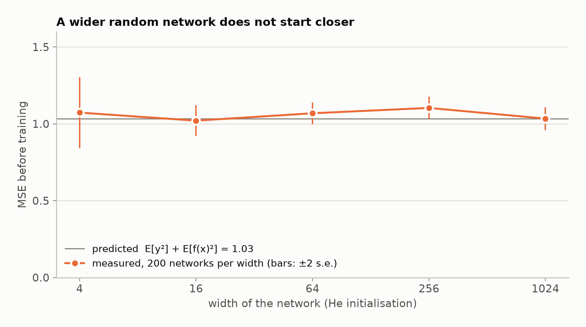

# 5. What the loss cannot see

**In the repository:**
[`RandomFunction.lean`](../lean/SquigglyLine/Theorem/RandomFunction.lean),
[`Marginal.lean`](../lean/SquigglyLine/Theorem/Marginal.lean).
**You need:** chapters 1 and 2.

## The idea

Before training, a network's weights are drawn at random. So the model is
random, and "the loss at the start" means the loss averaged over that
draw.

Here are two random models. Both produce numbers between −1 and 1.

- **The flat one.** Draw one number. Output it at every input. Every draw
  is a flat line.
- **The jagged one.** Draw a fresh number at every input. Every draw is as
  squiggly as a curve can be.

Now look at one input only. The flat model gives a uniform random number
there. So does the jagged one. Looking at one input at a time, you cannot
tell them apart.

A regression loss looks at one input at a time. On a data point it reads
the label and the model's output at that point's input, and nothing else.
So the two models have the same average loss, on any data. For a label
`y` and squared error, it is `y² + 1/3` for both.

This is the **marginal lemma**. The distribution of the output at one
single input is called the one-point **marginal**. The average loss at the
start depends on the marginals and on nothing else. How the output moves
between two inputs, which is what "squiggly" means, does not enter.

## The words

A randomly initialised model is a `RandomFunction`. These are the parts
of it you will see in statements.

| Name | Meaning |
|---|---|
| `.Param` | the type of its parameters |
| `.prior` | how the parameters are drawn |
| `.eval parameters` | the model you get with those parameters |
| `.marginal input` | the distribution of the output at one input |
| `.expected cost data` | a cost, averaged over the data and over the draw |

## The statement

```lean
theorem expected_residualLoss_congr [MeasurableSpace Inputs]
    (loss_is_measurable : Measurable loss_fn)
    (same_marginals : random_model.marginal = other_model.marginal)
    (data_distribution : DataDistributionOver Inputs) :
    let expected_loss :=
      random_model.expected (GET_RESIDUAL_LOSS loss_fn) data_distribution
    let other_expected_loss :=
      other_model.expected (GET_RESIDUAL_LOSS loss_fn) data_distribution
    expected_loss = other_expected_loss := by
```

Read aloud: *two random models with the same marginals have the same
expected loss, for any loss on the residual and any data.*

`GET_RESIDUAL_LOSS loss_fn` is a loss that reads only
`label - model(input)`. Squared error and absolute error are both of this
kind. `Measurable` is fine print that every loss in common use passes.

## Why it is true

The expected loss is an average of averages: over the data points, and
for each data point over the draw of the parameters. Take one data point.
Its loss reads the output at one input. So its average over the draw is
an average over the marginal at that input
(`integral_residualLoss_eq_integral_marginal`). Equal marginals give
equal averages, one data point at a time, and so in total.

## What it does to the conjecture

Claim 3 of chapter 1 said a curve nearer to the data starts with a
smaller loss. The nearest distance is not a one-point quantity: it
depends on the curve at inputs to the side. The loss is a one-point
quantity. So a family of models can get nearer and nearer while its loss
does not move at all. Chapter 6 builds such a family.

It also explains a measurement. Untrained networks of five widths, from 4
to 1024, start with the same error.



Standard initialisation is designed to keep the size of the output the
same at every width, and squared error at the start reads only that. This
part is **measured**, not proved here.

## What is not shown

A cost that reads two inputs at once is not covered, and the nearest
distance is such a cost. That is not a gap in the lemma. It is the reason
the two distances of chapter 1 can part ways.

## Check yourself

1. A random model outputs a fair coin flip, +1 or −1, the same at every
   input. Another flips a fresh coin at every input. The data is one
   point with label 0. What is the expected squared error of each?
2. Would the lemma still hold for absolute error?
3. Two random models have the same marginals. Must their draws look
   alike?

**Answers.** (1) Both are 1. (2) Yes. It holds for any loss that reads
only the residual. (3) No. The flat and jagged models have the same
marginals and look nothing alike.

Previous: [4. Nearness](04-nearness.md) · Next: [6. The theorem for sines](06-the-sine.md)
