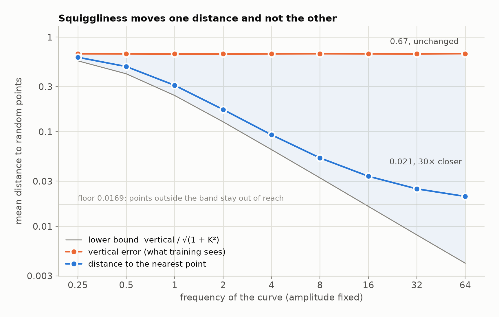

# 6. The theorem for sines

**In the repository:**
[`SquigglyLineTheorem.lean`](../lean/SquigglyLine/Theorem/SquigglyLineTheorem.lean),
[`RandomPhase.lean`](../lean/SquigglyLine/Theorem/RandomPhase.lean),
[`SineCloser.lean`](../lean/SquigglyLine/Theorem/SineCloser.lean),
[`Verdict.lean`](../lean/SquigglyLine/Theorem/Verdict.lean).
**You need:** chapters 3, 4 and 5.

## The idea

Now put the three results together on one family of curves:

```
curve(input) = amplitude × sin(frequency × input + phase)
```

The `frequency` is the squiggliness dial. The `phase` is drawn at random,
which makes the curve a random model. The data's labels lie in the band
the sine sweeps, from `−amplitude` to `amplitude`.

Turn the dial up and four things are true.

1. **The distance is squeezed between two bounds.** Chapter 4 gives the
   top: a sine passes every height of its band within half a wave, so the
   nearest distance is at most `PI / frequency`. Chapter 3 gives the
   bottom: the steepest slope of this sine is `amplitude × frequency`, so
   the nearest distance is at least
   `vertical_error / √(1 + (amplitude × frequency)²)`.
2. **The average distance goes to zero.** It is at most `PI / frequency`.
3. **The average loss is the same at every frequency.** Chapter 5: a
   random phase makes the output at any one input have the same
   distribution, whatever the frequency.
4. **A small shift fits any target.** Chapter 4 again: moving each input
   by at most `PI / frequency` makes the sine equal any target in the
   band.

That is the squiggly line theorem for sines. Closer, steeper, no better
at the start, and the closeness is a distance to move.

## The statement

The theorem is one statement with four named claims. Here is the first,
as it stands in the file. The other three are written the same way.

```lean
    -- Claim 1: the distance is squeezed between two bounds.
    let claim_1_distance_is_squeezed : Prop :=
      HOLDS_FOR_EVERY_SINE amplitude fun frequency phase =>
        ∀ data_point : DataPoint ℝ,
          let curve            := DRAW_SINE_CURVE amplitude frequency phase
          let vertical_error   := GET_VERTICAL_ERROR curve data_point    -- orange line in the graph: what training sees
          let nearest_distance := GET_NEAREST_DISTANCE curve data_point  -- blue line in the graph: what the eye sees
          let slope_bound      := √(1 + (amplitude * frequency) ^ 2)     -- Pythagoras: 1 across, amplitude * frequency up (steepest slope)
          let lower_bound      := vertical_error / slope_bound           -- a curve no steeper than that cannot pass any closer
          let upper_bound      := PI / frequency                         -- half a wave: within it the sine passes every height
          let label_is_in_band :=
            IS_IN_SINE_BAND amplitude (GET_LABEL data_point)             -- a sine never leaves its band
          let is_above_lower_bound := lower_bound ≤ nearest_distance
          let is_below_upper_bound := nearest_distance ≤ upper_bound
          label_is_in_band →
            is_above_lower_bound ∧ is_below_upper_bound
```

`HOLDS_FOR_EVERY_SINE amplitude fun frequency phase => ...` reads "for
every frequency above zero and every phase, the following holds". The
theorem ends with one line that only combines names:

```lean
    claim_1_distance_is_squeezed ∧
    claim_2_distance_vanishes ∧
    claim_3_loss_is_flat ∧
    claim_4_warp_fits_any_target := by
```

Open the file and read the other three claims. With chapter 2 in hand,
each should read like a short script.

## Why it is true

Nothing new is needed. The file's proof is four short blocks, one per
claim, and each calls a lemma from the earlier chapters.

| Claim | Lemma | From |
|---|---|---|
| 1, upper bound | `sin_coversWithin`: a sine reaches every height within half a wave | chapter 4 |
| 1, lower bound | `lipschitzWith_sine`: its slope is at most `amplitude × frequency` | chapter 3 |
| 2 | `tendsto_expected_nearestDist_sineWave` | claim 1, averaged |
| 3 | `marginal_sineWave_eq`: the marginal does not depend on the frequency | chapter 5 |
| 4 | `sineWave_exists_warp` | chapter 4 |

The one step worth a sentence is claim 3. The output at an input is
`amplitude × sin(frequency × input + phase)`. The phase is uniform round
the circle. Adding `frequency × input` to a uniform angle gives a uniform
angle. So the output has the same distribution at every input and at
every frequency.

## The verdict on the conjecture

[`Verdict.lean`](../lean/SquigglyLine/Theorem/Verdict.lean) writes the
"learning" claim of chapter 1 as a statement and proves it false for this
family (`not_learningClaim_sineWave`). `closer_but_no_better` in
[`SineCloser.lean`](../lean/SquigglyLine/Theorem/SineCloser.lean) puts
the two halves side by side: the nearest distance goes to zero while
every regression loss stays exactly where it was.

## What the experiment shows

Sines of one amplitude with a random phase. Only the frequency changes.

| frequency | nearest distance | vertical error |
|---|---|---|
| 0.25 | 0.6129 | 0.6672 |
| 1 | 0.3095 | 0.6649 |
| 4 | 0.0928 | 0.6663 |
| 16 | 0.0338 | 0.6665 |
| 64 | 0.0207 | 0.6688 |



The nearest distance falls thirty times. The vertical error does not
move. The theorem says this is no accident of the experiment.

## Check yourself

1. At frequency 10, what is the upper bound on the nearest distance?
2. The amplitude is 1 and the frequency is 100. A data point has
   vertical error 0.5. What is the lower bound on its nearest distance?
3. Why does the theorem ask for the labels to be in the band?

**Answers.** (1) `PI / 10`, about 0.31. (2) `0.5 / √(1 + 100²)`, about
0.005. (3) A sine never leaves its band, so it cannot come near a label
far outside it, however fast it wiggles. In the experiment this shows up
as a floor under the distance.

Previous: [5. What the loss cannot see](05-the-blind-loss.md) · Next: [7. The theorem for any function](07-any-function.md)
