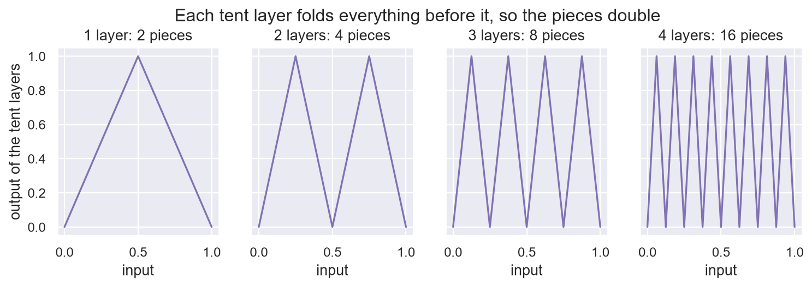
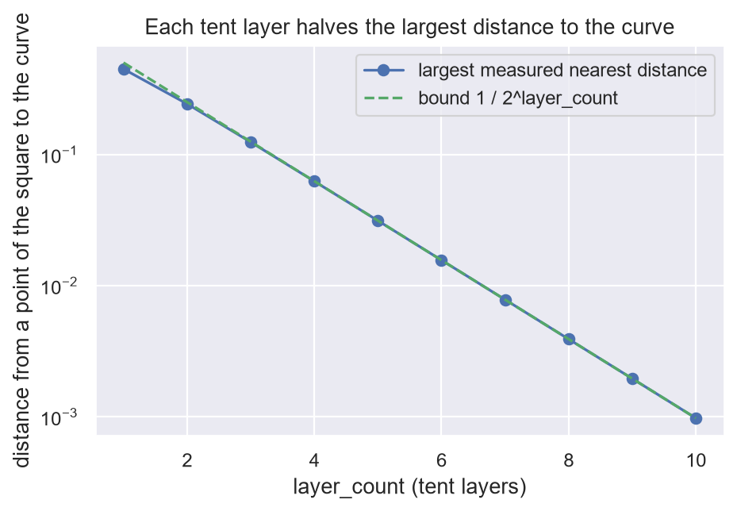
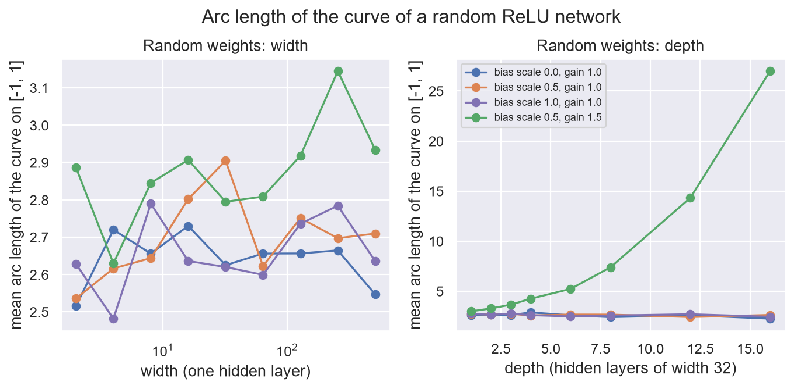

# 8. Folds

**In the repository:**
[`NarrowChain.lean`](../lean/SquigglyLine/Networks/NarrowChain.lean),
[`Depth.lean`](../lean/SquigglyLine/Networks/Depth.lean),
[`TentCloser.lean`](../lean/SquigglyLine/Networks/TentCloser.lean),
[`Bridge.lean`](../lean/SquigglyLine/Networks/Bridge.lean),
[`DepthSeparation.lean`](../lean/SquigglyLine/Supporting/NetworkShape/DepthSeparation.lean).
**You need:** chapters 4 and 7.

Part I was about curves. Part II is about networks. The first question is
the "parameters" claim of chapter 1: can a network buy squiggliness, and
with what?

## The idea

A ReLU neuron computes `max(value, 0)`. Its graph is flat and then
straight, with one corner. To draw a squiggly curve, a network has to
make many corners.

**One neuron per layer makes none that count.** A chain of single neurons,

```
relu(weight_1 × relu(weight_2 × relu(weight_3 × x + bias_3) + bias_2) + bias_1)
```

only ever rises, or only ever falls. Each layer does, and a chain of
such steps does too. It **never turns**, however deep it is.

**Two neurons per layer can fold.** This layer is called the tent:

```lean
noncomputable def APPLY_TENT
    (input : ℝ) : ℝ :=
  let first_neuron  := max input 0            -- ReLU: zero until the input passes 0
  let second_neuron := max (input - 1 / 2) 0  -- ReLU: zero until the input passes the fold at 1/2
  2 * first_neuron - 4 * second_neuron        -- slope 2 before the fold, and 2 - 4 = -2 after it
```

On the interval from 0 to 1 it goes up from 0 to 1 and back down to 0. It
folds the interval in half.

**Each new layer folds everything the earlier ones made.** Apply the tent
twice. At the inputs 0, 1/4, 1/2, 3/4 and 1 the output is 0, 1, 0, 1, 0.
Check one: the tent of 1/4 is 1/2, and the tent of 1/2 is 1. So two
layers draw four straight pieces. In general `layer_count` layers draw
`2 ^ layer_count` pieces with `2 × layer_count` neurons. The turns are
multiplied by depth and only added by width.



## Folding is squeezing

Each fold halves the reach of chapter 4. After `layer_count` folds every
label between 0 and 1 is hit within `1 / 2 ^ layer_count` of every input
(`iterate_tent_covers`). So by chapter 4 the curve is that close to every
point of the unit square:

```lean
theorem nearestDist_iterate_tent_le
    (layer_count : ℕ)
    (data_point : DataPoint ℝ)
    (input_in_unit : data_point.1 ∈ Set.Icc (0 : ℝ) 1)
    (label_in_unit : data_point.2 ∈ Set.Icc (0 : ℝ) 1) :
    let nearest_distance :=
      GET_NEAREST_DISTANCE (APPLY_TENT^[layer_count]) data_point
    let max_gap := 1 / 2 ^ layer_count  -- the gap found by `iterate_tent_covers`
    nearest_distance ≤ max_gap := by
```

`APPLY_TENT^[layer_count]` is the tent applied `layer_count` times: a
network that many layers deep. `Set.Icc 0 1` is the interval from 0 to 1.

So for this family the conjecture's chain "more layers, squigglier,
closer" holds, at an exponential rate. Ten layers pass within a
thousandth of every point.



And by chapter 3 the price is slope: each fold
doubles it.

## Depth is the logarithm of frequency

There is an exact link between this network and the sine of chapter 6.
Look at the tent's output through the fixed lens `sin²(PI/2 × y)`. One
fold doubles the angle inside the sine (`sin_sq_tent`), so `layer_count`
folds give a single wave of frequency `2 ^ layer_count`
(`sin_sq_iterate_tent`). A fold is a frequency doubling.

## Width cannot keep up

A network with one hidden layer of ReLU neurons gets one corner per
neuron. To stay within one half of what `L + 1` tent layers draw, it
needs `2 ^ L` neurons (**proved** in
[`DepthSeparation.lean`](../lean/SquigglyLine/Supporting/NetworkShape/DepthSeparation.lean)).
Depth pays for squiggle exponentially better than width.

Width is still enough for gentle targets. A one-hidden-layer network
with `2n` neurons comes within `2 × slope / n` of any function on the
unit interval with that slope
([`UniversalApproximation.lean`](../lean/SquigglyLine/Supporting/NetworkShape/UniversalApproximation.lean)).
The cost in neurons goes as slope over error. Slope again.

## Run it yourself

[`ch08_folds.ipynb`](../experiments/part2/ch08_folds.ipynb) checks the claims on
ReLU networks: a one-neuron chain, the tent layer, and random networks. All
numbers below are **measured**. An experiment is evidence, not a proof.

- **No turns.** 10000 random one-neuron chains, depth 1 to 40, were all
  monotone (644 were not constant). Control: random networks with two neurons
  per layer turned in 104 of 250 draws.
- **Zigzag.** For 1 to 12 tent layers the output on the grid `k / 2 ^ layer_count`
  is exactly 0, 1, 0, 1, and the curve has `2 ^ layer_count` pieces (4096 for
  12 layers, with 24 neurons).
- **Closeness.** The exact distance from 4004 random points of the unit square
  to the curve, never clamped, stayed within `1 / 2 ^ layer_count` for 1 to 10
  layers. The largest distance reaches 0.89, 0.97 and 0.99 of the bound for 1,
  2 and 3 layers, and about 1.00 of it from 4 layers on, so the bound is tight.
  Control: the unfolded line `output = input` has a point 0.71 away.
- **Doubling.** `sin²(PI/2 × tent^n(input))` equals `sin²(2^n × PI/2 × input)`
  to `1e-13` for 1 to 10 folds. It fails for negative inputs, as the hypothesis
  says.
- **Random weights.** The arc length of the curve on [-1, 1], averaged over 60
  networks. **Width** is flat: from width 8 to width 512 it changes by -4% to
  +3% (about 2.6 to 2.9 in every setting). **Depth** does not bear the
  chapter's sentence out. With He scaling of the weights, depth 1 to 16 at
  width 32 changed the length by -14%, -3% and -11% at bias scales 0, 0.5 and 1:
  no growth. With weights 1.5 times He's variance it grows, and not "a little":
  from 3.0 at depth 1 to 27 at depth 16.



To run it:

```bash
jupyter nbconvert --to notebook --execute --inplace experiments/part2/ch08_folds.ipynb
```

## What is not shown

The weights of the tent are **chosen**. A network with **random** weights
is another matter. **Measured**: with random weights, more width does
not make the curve longer. What depth does turns on the scale of the
weights. At the standard scale the notebook above finds no growth from 1
to 16 layers. With weights of one and a half times that variance the
curve grows about ninefold. An older script in this repository, with a
different setup, found a modest growth. So "depth makes a random network
squigglier" is not a safe sentence without naming the scale. Nothing
about random weights is proved here.

## Check yourself

1. What does the tent do to the input 0.3? And two tents in a row?
2. How many straight pieces do 5 tent layers draw, with how many
   neurons? How many neurons would one hidden layer need for the same
   number of pieces?
3. How many tent layers bring the curve within 0.01 of every point of
   the unit square?

**Answers.** (1) 0.6, and then 0.8. (2) 32 pieces with 10 neurons. One
hidden layer needs about 31, one per corner. (3) Seven, since `2 ^ 7` is
128.

Previous: [7. The theorem for any function](07-any-function.md) · Next: [9. Travel](09-travel.md)
