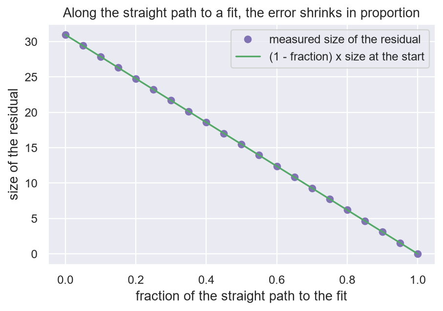
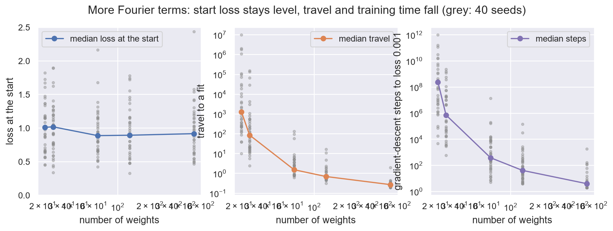

# 9. Travel

**In the repository:**
[`LinearModel.lean`](../lean/SquigglyLine/Networks/LinearModel.lean),
[`ExchangeRate.lean`](../lean/SquigglyLine/Networks/ExchangeRate.lean),
note [`fourier-parameters.md`](../docs/networks/fourier-parameters.md).
**You need:** chapters 1 and 5.

## The idea

Chapter 5 said a bigger model does not start with a lower loss. Chapters
4 and 7 said nearness is a distance to move. This chapter moves to the
place where that distance can be measured: the space of the weights.

Training moves the weights from where they start to somewhere that fits
the data. Call the distance from the start to the nearest weights that
fit every data point the **travel**. The claim of this chapter:

> A bigger model does not start lower. It starts **nearer to a fit**.

## The setting

The proofs are for a model that is **linear in its weights**: the vector
of its outputs on the data is a matrix times the weights. A Fourier
series is like this in its coefficients. A network is like this in its
last layer. In statistics this is plain linear regression on fixed
features.

| Name | Meaning | In Python |
|---|---|---|
| `predict weights` | the model's outputs on the data | `matrix @ weights` |
| `GET_RESIDUAL` | `labels - predict(weights)`: what is left to fit | |
| `GET_TRAVEL` | distance from the start to the nearest fit | |

## Three facts

**1. On the straight path to a fit, the error shrinks in proportion.**

```lean
theorem residual_along
    (end_weights_fit : predict end_weights = labels)
    (fraction : ℝ) :
    let weights_on_path    := MOVE_ALONG start_weights end_weights fraction
    let residual_on_path   := GET_RESIDUAL predict labels weights_on_path
    let residual_at_start  := GET_RESIDUAL predict labels start_weights
    let remaining_fraction := 1 - fraction  -- the part of the path still ahead
    residual_on_path = remaining_fraction • residual_at_start := by
```



Half way along the path, half the error is gone. So the nearer the fit,
the more error a fixed amount of movement removes
(`exists_within_budget`).

**2. More weights never move the nearest fit further away**
(`travel_coprod_le`). A bigger model can always leave its new weights
alone and do what the smaller one did.

**3. The exchange rate.** Suppose that, seen from the data side, the
features are at right angles to each other and each has squared length
`squared_length`. The repository calls that `HAS_TIGHT_FEATURES`. Then
the travel is known exactly.

```lean
theorem travel_eq
    (features_are_tight : HAS_TIGHT_FEATURES predict squared_length)
    (squared_length_pos : 0 < squared_length)
    (labels : Outputs)
    (start_weights : Weights) :
    let linear_predict : LinearPredictor Weights Outputs := predict
    let travel        := GET_TRAVEL linear_predict labels start_weights
    let residual_size :=
      ‖GET_RESIDUAL linear_predict labels start_weights‖
    let exchange_rate := √squared_length  -- parameter distance per unit of residual, inverted
    travel = residual_size / exchange_rate := by
```

The error and the travel are one quantity in two units. Adding
parameters changes the rate between them.

## An example you can do by hand

One data point. The model has `m` features, and each equals 1 at that
point, so the prediction is the sum of the weights. The prediction is
off by 1.

The cheapest fix is to add `1 / m` to every weight. The length of that
move is `√(m × (1/m)²)`, which is `1 / √m`. Here `squared_length` is `m`,
and the theorem says the same: travel is `1 / √m`.

With 4 features the travel is 0.5. With 100 it is 0.1. The error at the
start was 1 both times.

## What the experiment shows

A Fourier series with random coefficients, scaled so the output has the
same spread at every size, fitted to 20 points with random labels.

| parameters | loss at start | travel to a fit | gradient-descent steps |
|---|---|---|---|
| 9 | 0.65 | no fit | never |
| 21 | 0.65 | 448 | 188 000 000 |
| 25 | 0.64 | 35.5 | 79 300 |
| 65 | 0.71 | 1.61 | 166 |
| 129 | 0.66 | 0.48 | 13 |
| 513 | 0.63 | 0.23 | 3 |

The loss at the start is flat, as chapter 5 says it must be. The travel
falls, and training time falls with it. For this model `squared_length`
is about the number of parameters, so the exchange rate predicts 0.45
and 0.22 for 129 and 513 parameters. Measured: 0.48 and 0.23.

The row with 21 parameters, just enough to fit 20 points, is the worst.
Chapter 10 comes back to it.



## Run it yourself

[`ch09_travel.ipynb`](../experiments/part2/ch09_travel.ipynb) checks the four
claims on a model that is linear in its weights (a Fourier series whose sine and
cosine coefficients are trained). All numbers below are **measured**. An
experiment is evidence, not a proof.

- **Straight path.** On a random 20 by 25 problem the residual at 31 fractions
  of the path equals `(1 - fraction)` times the residual at the start, entry by
  entry, to `1e-13`. A point off the path breaks it, so the check can fail.
- **More weights.** Adding 1, 5, 20 or 100 weights that start at zero never
  raised the travel: 0 violations in 800 trials, and it fell in all 800. New
  random models of the bigger size, which do not contain the old one, travelled
  further than the old one in 301 of 800 trials. The nesting matters. The new
  weights must start at zero, as in the Lean statement.
- **Tight features.** The hand example gives 0.5000 for 4 features and 0.1000
  for 100. Three random tight examples match `residual_size / √squared_length`
  to `1e-10`. Features that are not tight miss it (4.66 against 3.66).
- **The sweep** (loss `0.5 × mean(residual²)`, steps to loss 0.001 at step size
  one over the largest curvature, counted exactly from the singular values and
  equal to real gradient descent where that is short). The median of 40 seeds:

| parameters | loss at start | travel | steps |
|---|---|---|---|
| 9 | 0.91 | no fit | never |
| 21 | 1.01 | 1290 | 245 000 000 |
| 25 | 1.02 | 86 | 720 000 |
| 65 | 0.89 | 1.54 | 387 |
| 129 | 0.89 | 0.70 | 42 |
| 513 | 0.92 | 0.27 | 4 |

The loss stays level and the travel and the steps fall, as in the table above.
The size of the numbers differs from the table above. The loss here is about 0.9
rather than 0.65, and the travel at 129 is 0.70 rather than 0.48. The kind is the
same. The 21-parameter row is by far the worst, and the individual draws vary a
lot: the 513-parameter travel agrees with `residual_size / √squared_length` to
within 1% (median ratio 1.00), but at 129 parameters the median ratio is 1.16 and
single draws go up to 34 times the prediction. The exchange rate is a good guide
only when the features are nearly tight. The experiment did not test why some
draws are far from it.

Run it with:

```bash
jupyter nbconvert --to notebook --execute --inplace experiments/part2/ch09_travel.ipynb
```

## What is not shown

- **The rate for real features.** The exact formula needs tight features.
  That the Fourier model is nearly tight is measured, not proved.
- **Models that are not linear in their weights.** A deep network's
  features move during training. Then the travel is not a straight line
  and none of this applies as stated.

## Check yourself

1. You are 30% of the way along the straight path to a fit. How much of
   the error is left?
2. The features are tight with `squared_length = 25` and the error at the
   start has size 2. What is the travel?
3. A colleague says: "The bigger model trains faster because it starts
   with a lower loss." What do you answer?

**Answers.** (1) 70%. (2) `2 / √25`, which is 0.4. (3) It starts with the
same loss. It trains faster because a fit is nearer in weight space.

Previous: [8. Folds](08-folds.md) · Next: [10. The kernel](10-the-kernel.md)
