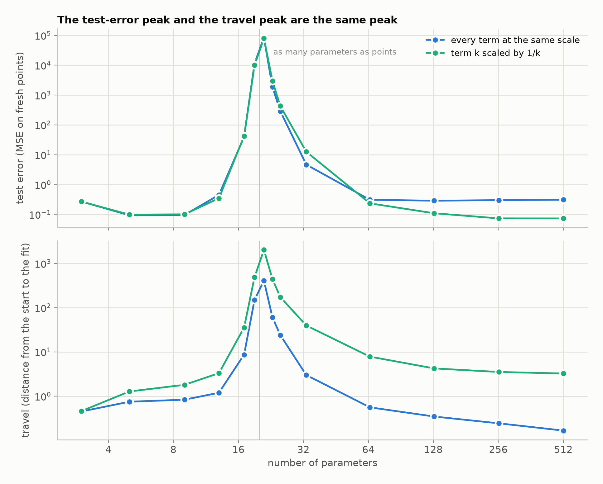
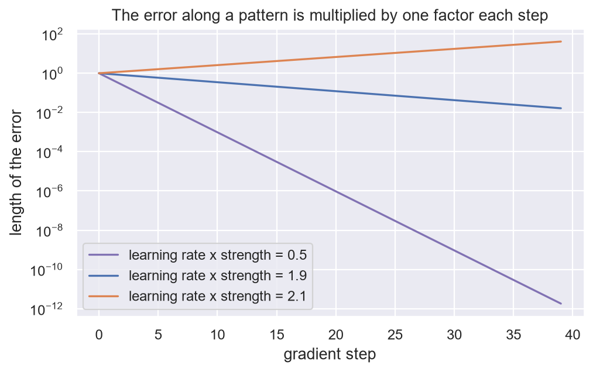
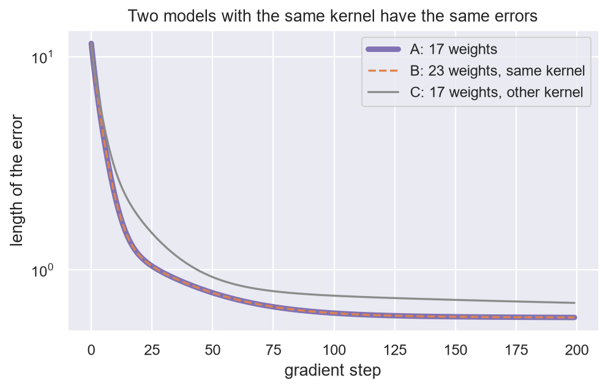
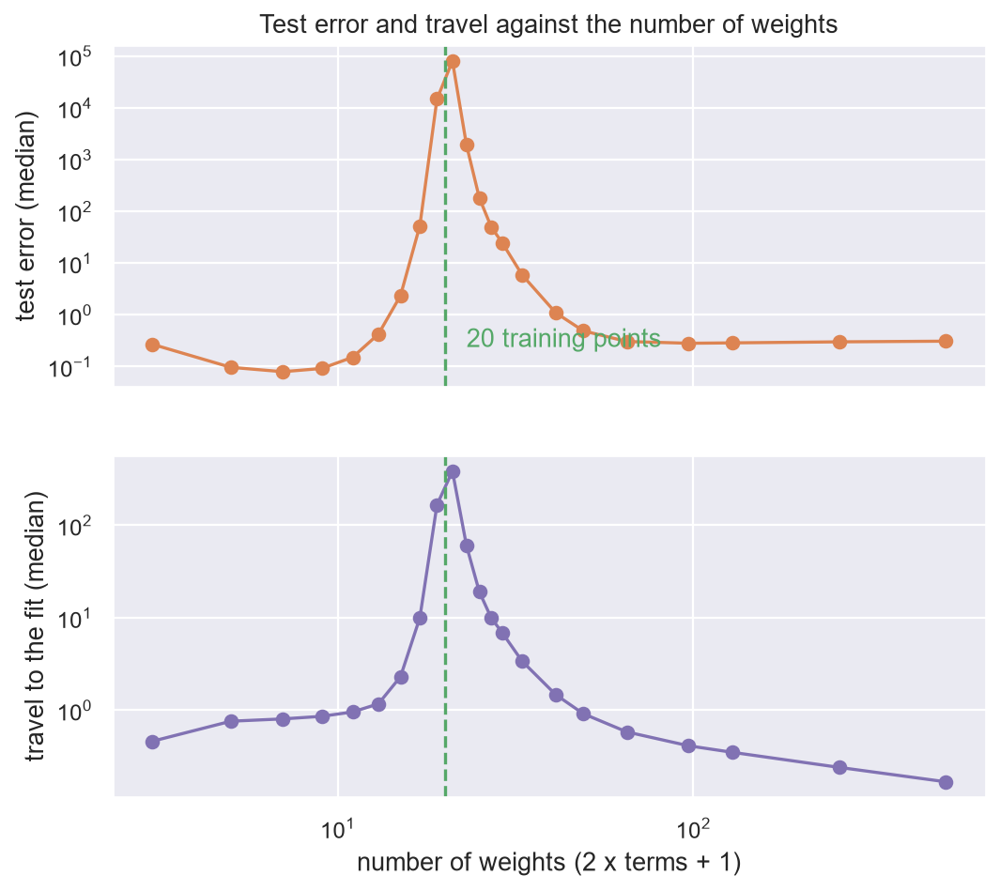

# 10. The kernel

**In the repository:**
[`Kernel.lean`](../lean/SquigglyLine/Networks/Kernel.lean),
[`DoubleDescent.lean`](../lean/SquigglyLine/Networks/DoubleDescent.lean),
notes [`double-descent.md`](../docs/networks/double-descent.md) and
[`fourier-and-relu-bridge.md`](../docs/networks/fourier-and-relu-bridge.md).
**You need:** chapter 9.

## The idea

Chapter 9 measured how far the weights have to go. This chapter watches
them go, one step of gradient descent at a time. The surprise is that
you never need to look at the weights.

For each pair of data points, ask how much their feature vectors
overlap. Put those numbers in a table. That table is the **kernel**. It
says which data points the model treats as alike.

> One gradient step changes the error by: learning rate, times the
> kernel, times the error. The weights do not appear.

## The statement

```lean
theorem residual_gradientStep
    (predict : Weights →L[ℝ] Outputs)
    (labels : Outputs)
    (learning_rate : ℝ)
    (weights : Weights) :
    let linear_predict : LinearPredictor Weights Outputs := predict
    let stepped_weights :=
      TAKE_GRADIENT_STEP predict labels learning_rate weights
    let residual_after := GET_RESIDUAL linear_predict labels stepped_weights
    let residual_before := GET_RESIDUAL linear_predict labels weights
    let kernel_applied  := predict (adjoint predict residual_before)  -- `K r`, with `K = A A†`
    residual_after = residual_before - learning_rate • kernel_applied := by
```

`adjoint predict` is the matrix of `predict` turned on its side: the
transpose. So `predict (adjoint predict ...)` is the matrix times its
transpose. That is the kernel.

## Why it is true

A gradient step adds `learning_rate × transpose × error` to the weights.
That is what the gradient of squared error is, and it is the definition
of `TAKE_GRADIENT_STEP`. The model is linear, so its outputs change by
the matrix times that. The new error is the old error minus that
change. It is three lines of algebra.

## Same kernel, same learner

Two models with the same kernel go through the same errors at every
step (`residual_iterate_gradientStep_eq`), and their nearest fits are
equally far away (`travel_eq_of_kernel_eq`). Their weights can be
entirely different things. A Fourier series and a ReLU network with a
trained last layer are the same learner whenever their kernels agree.

## One direction at a time

Some patterns of error are simply scaled by the kernel. Call the scale
the **strength** of the model along that pattern. For an error along a
pattern of strength `strength`, the statement above reads

```
error_after = (1 − learning_rate × strength) × error_before
```

So each step multiplies that part of the error by one fixed factor.

**Try numbers.** With learning rate 0.1 and strength 5 the factor is
0.5: the error halves every step. With strength 0.05 the factor is
0.995, and halving takes about 140 steps. Strong directions are learned
first. Weak ones wait.

This one factor is behind a long list of known effects, and chapter 13
goes through them. Two are worth having now.

- If `learning_rate × strength` is above 2, the factor is below −1 and
  the error grows. That is the largest usable learning rate.
- With tight features (chapter 9) every direction has the same strength,
  so the whole error shrinks by `(1 − learning_rate × squared_length)`
  per step, and the learning rate `1 / squared_length` fits in one step.

## Double descent

The travel can be read off the kernel too. Along a pattern of strength
`strength`:

- if the strength is zero, no weights fit that part of the labels
  (`not_exists_fit_of_kernel_eq_zero`);
- if it is positive, the travel is exactly the size of that part divided
  by `√strength` (`travel_eq_of_eigen`).

Now grow a model past the point where it can just fit its data. Below
that point some strengths are zero: the model cannot fit the noise, and
does not try. Just past it, the last direction to appear is very weak,
so the travel is enormous. Far past it, every direction is strong and
the travel is short.

A fit that is near the start cannot behave wildly: its output anywhere
differs from the starting model's by at most the size of the features
there times the travel (`exists_fit_near_start`). A fit that is far away
has no such leash.

| parameters | test error | travel to the fit |
|---|---|---|
| 5 | 0.094 | 0.75 |
| 21 | 83 800 | 409 |
| 65 | 0.31 | 0.56 |
| 513 | 0.31 | 0.17 |



Unable to fit the noise is safe. Barely able is the worst case. Easily
able is safe again. That is double descent.

## Run it yourself

[`ch10_the_kernel.ipynb`](../experiments/part2/ch10_the_kernel.ipynb) uses a model that is linear in its
weights: fixed Fourier features, with the kernel `features @ features.T`. Each experiment checks one claim.

- **One step.** Against PyTorch's own gradient step, the error after one step
  equals the old error minus the learning rate times the kernel times the old
  error, to within `2e-15`, for random weights.
- **Same kernel.** A second model with 23 weights instead of 17, different
  weights, and the same kernel goes through the same errors as the first for
  200 steps (largest gap `2e-15`). A model with a different kernel and the same
  starting error does not (gap 0.76).
- **One factor per step.** Along every pattern of the kernel the error is
  multiplied by `1 − learning_rate × strength` (gap `5e-14`). On the strongest
  pattern, at `learning_rate × strength` of 1.9 the error falls to 0.016 in 39
  steps, and at 2.1 it grows to 41 from a start of 1.
- **Travel.** For each of 12 patterns the travel is the size divided by the
  root of the strength (gap `2e-10`), and for a mix the travel squared is the
  sum of those terms.
- **Double descent.** 20 noisy training points, 2000 held-out test points, and
  the number of weights swept from 3 to 513 (1 to 256 Fourier terms), median
  over 200 data sets. Both the test error and the travel peak at 21 weights,
  one more than the 20 training points, where the model has just enough terms
  to fit. The measured test error is 0.097 at 5 weights, 80 800 at 21, 0.305 at
  65 and 0.31 at 513. The travel is 0.76, 385, 0.58 and 0.17. That is the
  chapter's table to within the spread of different data sets. The test-error
  peak is measured here, not proved.







These are measurements of one model, not proofs. The Lean theorems cover
every linear model.

Run it with:

```bash
jupyter nbconvert --to notebook --execute --inplace experiments/part2/ch10_the_kernel.ipynb
```

## What is not shown

- **That the test error peaks there.** The travel peak is proved. That
  the test error peaks in the same place is measured.
- **A kernel that moves.** Everything here is for fixed features. In a
  real network the features change as it trains, and the kernel changes
  with them. This is the main limit of the whole repository, and
  chapter 47 says more.

## Check yourself

1. The learning rate is 0.5. Along a pattern of strength 1, what happens
   to the error each step? Along a pattern of strength 5?
2. A part of the labels has size 3 along a pattern of strength 0.0001.
   What is the travel for that part?
3. Two models have different weights and different numbers of weights
   but the same kernel. Will their training curves differ?

**Answers.** (1) It halves. At strength 5 the factor is −1.5, so it
grows by half each step and flips sign. (2) `3 / √0.0001`, which is 300.
(3) No.

Previous: [9. Travel](09-travel.md) · Next: [11. The lift](11-the-lift.md)
