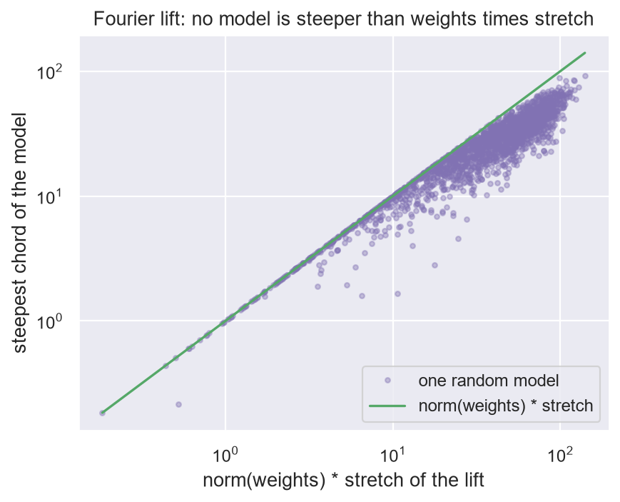
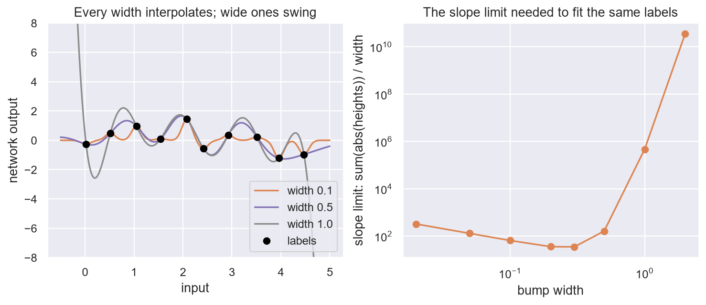
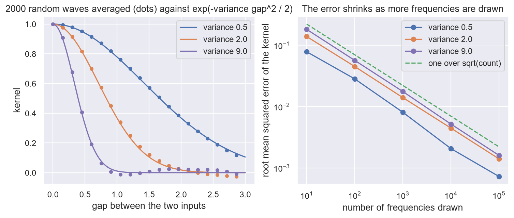

# 11. The lift

**In the repository:**
[`Lift.lean`](../lean/SquigglyLine/Networks/Lift.lean),
[`FourierLift.lean`](../lean/SquigglyLine/Networks/FourierLift.lean),
[`RadialBasis.lean`](../lean/SquigglyLine/Networks/RadialBasis.lean),
[`RandomFourier.lean`](../lean/SquigglyLine/Networks/RandomFourier.lean),
[`Positions.lean`](../lean/SquigglyLine/Networks/Positions.lean),
note [`kernel-trick.md`](../docs/networks/kernel-trick.md).
**You need:** chapters 3, 7 and 10.

## The idea

Part I was about how squiggly the line is. Chapters 9 and 10 were about
how far the weights move. This chapter is the bridge between the two.

A model that is linear in its weights works in two steps. First it
**lifts** the input to a list of features, usually a much longer list
than the input. Then it takes the dot product of that list with the
weights.

Upstairs, in the space of features, the model is a flat plane. Downstairs,
seen as a function of the input, it is a squiggly line.

> Squiggly below, flat above.

| Name | Meaning |
|---|---|
| `FeatureMap` | the lift: an input to its list of features |
| `EVALUATE_LIFTED_MODEL` | the model: lift, then dot with the weights |
| `GET_LIFT_KERNEL` | the overlap of two inputs upstairs |

## Four facts about any lift

1. **A point is on the squiggly line exactly when its lift is on the
   plane** (`embed_mem_curve_liftedModel_iff`).
2. **The slope downstairs is at most the size of the weights times the
   stretch of the lift** (`lipschitzWith_liftedModel`). The stretch is how
   much the lift can pull two nearby inputs apart. So chapter 3's price
   of nearness can be paid in two ways: big weights, or a lift that
   stretches.
3. **The kernel trick** (`liftedModel_add_sum`). If the weights have
   moved from their start only along the lifted data points, then the
   prediction at a new input is the starting prediction plus a sum over
   the data: a number for each data point, times the kernel between that
   point and the new input. The features themselves never have to be
   written down. Gradient descent only ever moves the weights that way.
4. **A warning** (`exists_lift_eq`). Any function at all is flat in some
   lift. So "it is flat upstairs" says something only when the lift is
   fixed before the data is seen.

## The Fourier lift

Wind the input round a circle:

```
lift(input) = (cos(frequency × input), sin(frequency × input))
```

A flat plane over that circle is, downstairs, a wave:
`cosine_weight × cos(...) + sine_weight × sin(...)`. This is the sine of
chapter 6, seen as a lifted model.

- The kernel of two inputs is `cos(frequency × gap)`, where `gap` is
  how far apart they are (`liftKernel_fourierLift`). It sees only the
  gap. So shifting the data and the question together changes no answer.
- The lift stretches distances by at most `frequency`
  (`lipschitzWith_fourierLift`). So by fact 2 the wave is no steeper than
  the size of its weights times its frequency. The frequency is the
  squeeze factor of chapter 7, now appearing as the stretch of a lift.



## Bumps

A radial basis network is a sum of bell-shaped bumps, one centred at each
of some chosen places, all of one width.

A bump of width `width` is the unit bump squeezed sideways by
`1 / width` (`bump_eq_compress`). So chapter 7 applies with `1 / width`
as the squeeze factor. Narrow bumps are steep, with slope up to
`1 / width`, and reach every label: once the bumps hardly overlap, they
fit any labels exactly (`exists_heights_of_gap`). Wide bumps of modest height
are gentle and cannot follow labels that change quickly. They can still
fit them, but only with very large heights (**measured**, below).



## The wave and the bump are one thing

Use many frequencies at once, drawn from a bell curve with variance
`variance`. The Fourier kernel, averaged over that draw, is

```
exp(−variance × gap² / 2)
```

which is the bump (`integral_liftKernel_fourierLift`). So a wide layer of
random waves and a radial basis network have the same kernel on
average, and by chapter 10 they are then the same learner. This is the
idea behind random Fourier features.



## Telling a transformer where a token is

The same reasoning covers position embeddings
([`Positions.lean`](../lean/SquigglyLine/Networks/Positions.lean)). The
overlap of the sinusoidal signals of two positions is a sum of cosines of
the gap between them, so it depends only on the gap. Rotary positions
turn the query and the key so that the score depends on the positions
only through the gap, and no vector changes length. A learned table ties
no two positions together.

## Run it yourself

[`ch11_the_lift.ipynb`](../experiments/part2/ch11_the_lift.ipynb) checks the
claims on a Fourier lift whose cosine and sine coefficients are the weights
(linear in the weights), and on Gaussian bumps. All numbers below are
**measured**. An experiment is evidence, not a proof.

- **Slope.** In 2000 random models with 1 to 8 frequencies, the steepest chord
  never passed the size of the weights times the stretch (largest ratio 1.000,
  so the bound is tight). Half the bound was broken in 1730 of 2000. For one
  frequency the stretch of the lift came within 0.01% of the frequency.
- **Kernel trick.** With 8 data points, 40 weights and a random start, after 300
  gradient steps the prediction at 50 new inputs matched the starting prediction
  plus coefficients times kernel, computed without the features, to `2e-14`. The
  prediction had moved by 6.7. A 1% change to one coefficient, or leaving out
  the starting prediction, breaks the match.
- **Fourier kernel.** The overlap of the lifts matched `cos(frequency × gap)` to
  `2e-14`. Shifting data and question together (by up to 1000) changed the
  kernel matrix and the predictions by under `1e-11`. The product kernel
  `x × y` changed by at least 2.3 under the same shifts.
- **Bumps.** The steepest slope of one bump was `0.6065 / width`, below
  `1 / width`. In 200 random networks the slope stayed under total height over
  width (largest ratio 0.57). With 10 inputs 0.5 apart, bumps of widths 0.02,
  0.05 and 0.1, where the theorem's condition holds, fit random labels to
  `1e-17`, with total height 6.6, the size of the labels. The wider bumps also
  fit, since the solve is exact, but needed total height 81.7 at width 0.5 and
  `4.7e5` at width 1.0.
- **Bell curve.** The kernel averaged over frequencies from a normal draw
  matched `exp(−variance × gap² / 2)`. The root mean squared error for variance 2
  fell from 0.139 with 10 frequencies to 0.0014 with 100 000, a log-log slope of
  −0.50 (−0.52 and −0.51 for variances 0.5 and 9). Uniform frequencies of the
  same variance missed it by 0.12.

One claim needed correcting. An earlier wording of this chapter said wide
bumps cannot fit the labels. In exact arithmetic they can, because the bump
matrix stays invertible. What the experiment shows is the price: the heights, and so the
slope limit, explode. The Lean theorem only promises a fit when the bumps are
narrow.

Run it with:

```bash
jupyter nbconvert --to notebook --execute --inplace experiments/part2/ch11_the_lift.ipynb
```

## What is not shown

A lift that is **learned**. In a deep network the earlier layers are the
lift, and training changes them. Everything here holds for the lift as
it stands at one moment.

## Check yourself

1. A Fourier lift has frequency 10. Two inputs are 0.01 apart. At most
   how far apart are their lifts?
2. Its weights have size 3. What is the most its slope can be?
3. Bumps of width 0.1 against bumps of width 1: which can fit labels
   that change quickly, and what do they pay?

**Answers.** (1) 0.1. (2) 30. (3) The narrow ones can, at modest
heights. They pay in slope: up to ten times steeper for the same
heights. The wide ones can only with very large heights.

Previous: [10. The kernel](10-the-kernel.md) · Next: [12. Layers as polarizers](12-polarizers.md)
