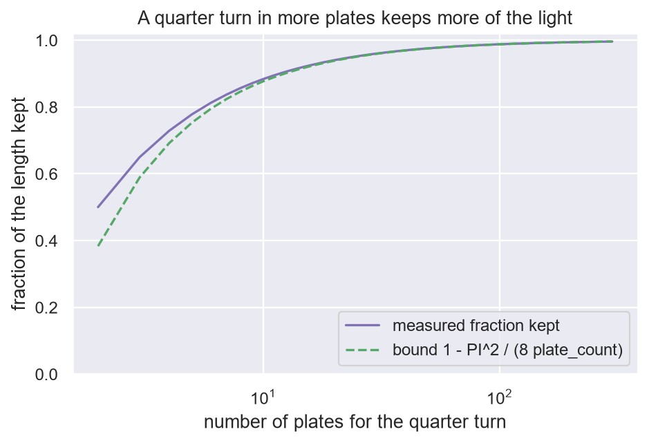

# 12. Layers as polarizers

**In the repository:**
[`Polarizer.lean`](../lean/SquigglyLine/Networks/Polarizer.lean),
[`ThreePolarizers.lean`](../lean/SquigglyLine/Networks/ThreePolarizers.lean),
[`MarkovChains.lean`](../lean/SquigglyLine/Networks/MarkovChains.lean),
notes [`three-polarizers.md`](../docs/networks/three-polarizers.md) and
[`wind-tunnel-and-polarizers.md`](../docs/networks/wind-tunnel-and-polarizers.md).
**You need:** chapter 8. This chapter is a picture, and nothing in Part
III depends on its proofs.

## The idea

A layer of a network does two things. It turns its input, and then it
keeps part of it. A polarizer does the same to light: it keeps only the
part of the light that lines up with its axis.

**ReLU is a wide polarizer.** Take a point in the plane and apply ReLU to
both coordinates. The result is the nearest point of the positive
quadrant (`relu2_nearest`). So ReLU is a projection: it presses each
point onto a region. A polarizer presses each arrow of light onto a line.

**Malus's law.** Light of strength `amplitude` meets a polarizer whose
axis is turned by an angle from the light. What passes has strength
`amplitude × cos(angle)` (`malus`). At 90° nothing passes
(`polarizer_crossed`).

## Three polarizers

Here is the surprise that makes the picture useful. Two plates at 90° to
each other block everything. Slip a third plate between them at 45° and
light gets through: each of the two 45° turns keeps `cos(45°)`, and
`cos(45°) × cos(45°)` is one half (`three_polarizers`).

Adding a plate let **more** light through. One big turn loses
everything. Two smaller turns lose half. And many small turns lose
almost nothing:

```lean
theorem quarter_turn_arrives
    {plate_count : ℕ}
    (at_least_two_plates : 2 ≤ plate_count) :                -- then each plate turns by at most 45°, small enough for the bound
    let turn_angle     := PI / (2 * plate_count)             -- a quarter turn is PI / 2, cut into equal steps
    let incoming_light := MAKE_LIGHT 1 0                     -- strength 1, pointing across
    let outgoing_light :=
      PASS_THROUGH_PLATES turn_angle plate_count incoming_light
    let kept_fraction  := cos turn_angle ^ plate_count       -- Malus's law, once per plate
    let light_pointing_up : LightArrow := (0, kept_fraction)
    let lower_bound    := 1 - PI ^ 2 / (8 * plate_count)     -- plate_count * turn_angle ^ 2 / 2, worked out
    let arrives_pointing_up      := outgoing_light = light_pointing_up
    let keeps_most_of_its_length := lower_bound ≤ kept_fraction
    arrives_pointing_up ∧ keeps_most_of_its_length := by
```

Read aloud: *turn light a quarter turn using `plate_count` plates. It
arrives pointing up, and it keeps at least `1 − PI² / (8 × plate_count)`
of its strength.* With 10 plates that is at least 87%. With 100, at
least 98.7%.

**Measured**, from the notebook below:



## Why it matters for networks

- **Depth is affordable.** A deep stack of layers that each turn the
  signal a little loses very little. A shallow stack that turns it all
  at once can lose it all.
- **Change things gradually.** The same sum explains warm-up, small
  learning rates and easy examples first: if the cost of a step goes as
  the square of its size, `N` small steps cost `1 / N` of one big one
  ([`SmallSteps.lean`](../lean/SquigglyLine/Supporting/Training/SmallSteps.lean)).
- **A layer has no memory.** What comes out of a layer depends only on
  what went in. So two inputs that land on the same place after some
  layer stay together for good (`merged_stays_merged`), and a state that
  every layer leaves alone is never left (`dead_stays_dead`). The second
  is the "dying ReLU" problem.

## A chain of chains

Training has the same shape one level up. Each training step runs the
chain of layers, and the steps themselves form a chain: the next weights
depend only on the current ones. For tight features (chapter 9) the
outer chain is the one-factor rule of chapter 10: after `step_count`
steps the error is `(1 − learning_rate × squared_length) ^ step_count`
times what it was (`HAS_TIGHT_FEATURES.residual_iterate_gradientStep`).

## Run it yourself

[`ch12_polarizers.ipynb`](../experiments/part2/ch12_polarizers.ipynb) checks the
six claims on exact small models: ReLU on the plane, polarizers as 2 by 2
projection matrices, random layers on a finite set of states, and a linear model
with tight features. All numbers below are **measured**. An experiment is
evidence, not a proof.

- **ReLU is a projection.** For 200 random points, the ReLU point is no further
  than any of 90 000 grid points of the quadrant (largest excess `4e-16`), and
  the best grid point is within 0.006 of it.
- **Malus's law.** At 721 angles and three amplitudes the passed length matches
  `amplitude × cos(angle)` to `2e-15`. A crossed plate passes `6e-17`, which is
  nothing.
- **Three polarizers.** 90° alone passes 0. 45° then 90° passes 0.500000.
- **Many small turns.** For 2 to 300 plates the light arrives pointing up with
  length `cos(turn_angle) ^ plate_count`, and the bound `1 − PI² / (8 × plate_count)`
  holds every time. Kept against bound: 0.5000 against 0.3831 at 2 plates, 0.8835
  against 0.8766 at 10, and 0.9877 against 0.9877 at 100 (the gap is 0.00008).
- **No memory.** Over 300 random stacks of 12 layers on 30 states, 311 390 merged
  pairs stayed merged (0 broken), and a state every layer fixes never moved.
  Controls: 530 138 pairs that were apart did merge later, and without the fixing
  state 0 moved in 293 of 300 stacks.
- **A chain of chains.** With tight features (8 points, 40 weights, squared
  length 5) the residual after 20 steps matches
  `(1 − learning_rate × squared_length) ^ step_count` times the start to `2e-15`
  for four learning rates, and one step with the rate one over `squared_length`
  leaves `9e-16`. With rows of different lengths the law fails (gap 0.17).

Run it with

```bash
jupyter nbconvert --to notebook --execute --inplace experiments/part2/ch12_polarizers.ipynb
```

## What is not shown

This is a way of seeing layers, with the arithmetic checked. A stack of
real polarizers is one linear map, so it is a network with no activation
function, and nothing has been built. The
[README](../README.md#a-network-made-of-polarizers) says what is missing.

## Check yourself

1. Light passes a plate turned 60° from it. How much of its strength is
   kept?
2. A quarter turn in 2 plates keeps one half. What does the bound in the
   theorem promise for 2 plates, and is it consistent?
3. Two inputs give the same values after layer 3 of a network. Can layer
   7 tell them apart?

**Answers.** (1) `cos(60°)`, one half. (2) At least `1 − PI² / 16`,
about 0.38. One half is more than that, so yes. (3) No, unless a skip
connection carries something round layers 3 to 7. Chapter 14.

Previous: [11. The lift](11-the-lift.md) · Next: [13. One factor, again and again](13-one-factor.md)
