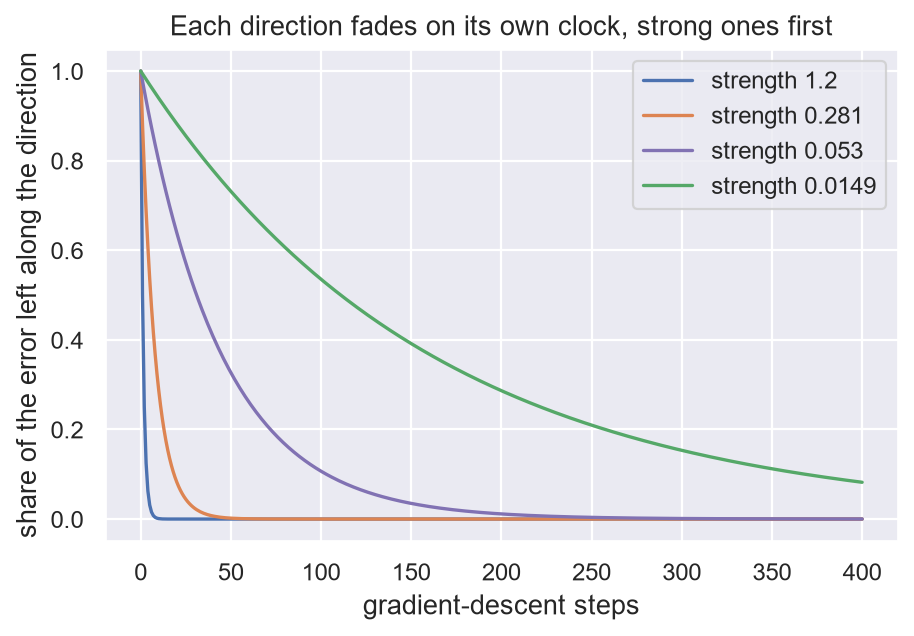
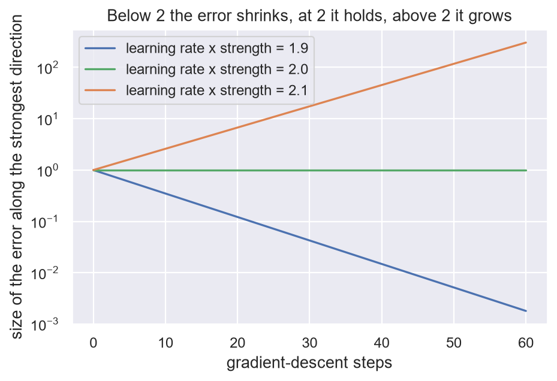
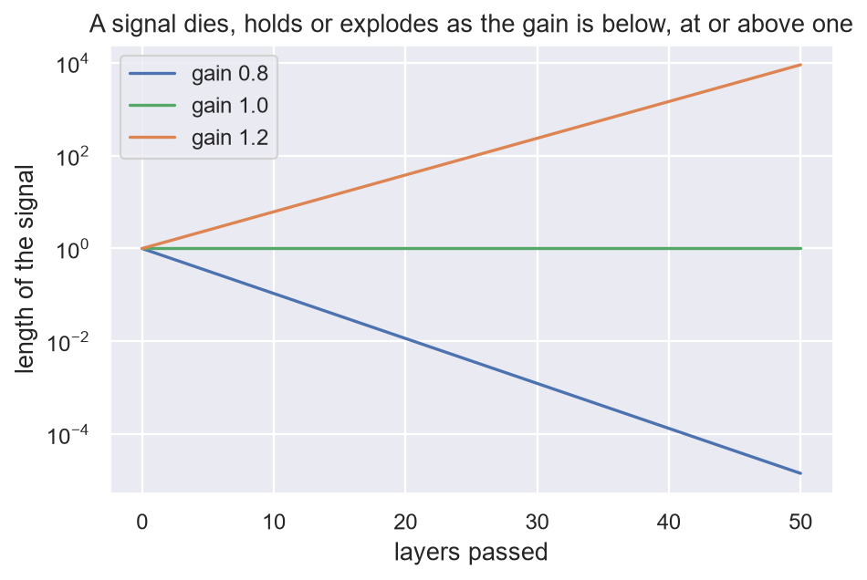

# 13. One factor, again and again

**In the repository:** the files in
[`Supporting/Training/`](../lean/SquigglyLine/Supporting/Training), with
notes in [`docs/supporting/training/`](../docs/supporting/training).
**You need:** chapter 10.
**The proofs, one by one:** part IV, chapters 17 to 27.

Part III takes the tools of the first two parts and points them at
well-known results of deep learning. It is a map: four short chapters.
Parts IV to VII then go over the same ground one proof at a time. Nothing here is needed for the
theorem. Every statement is for a simplified model, most often one with a
fixed kernel, and each linked note says what it does not show.

## The idea

Chapter 10 found that one step of gradient descent multiplies the error
along a direction by `1 − learning_rate × strength`. So `n` steps
multiply it by that factor `n` times.

That shape, one step multiplies by a factor, is the most common
statement in the repository. It is always proved the same way, by
repeating one step. And only three things can happen:

- the factor is **below one** in size: the thing fades;
- it is **exactly one**: the thing is carried unchanged;
- it is **above one**: the thing blows up.

## What it explains about training

| What practitioners see | The factor says | Proof |
|---|---|---|
| Networks learn the coarse pattern first. | Each direction has its own clock, `1 / (learning_rate × strength)`. Strong directions finish first. | [`SpectralBias`](../lean/SquigglyLine/Supporting/Training/SpectralBias.lean) |
| Stopping early keeps out noise. | Noise sits in weak directions, and their clocks have not run yet. | [`SpectralBias`](../lean/SquigglyLine/Supporting/Training/SpectralBias.lean) |
| There is a largest learning rate. | The error shrinks when `learning_rate × strength` is below 2, holds at 2 and grows past it. | [`EdgeOfStability`](../lean/SquigglyLine/Supporting/Training/EdgeOfStability.lean) |
| Weight decay and early stopping do the same job. | Decay leaves the share `decay / (strength + decay)` of the error. Stopping after `t` steps cuts at least as hard as decay `1 / (learning_rate × t)`. | [`WeightDecay`](../lean/SquigglyLine/Supporting/Training/WeightDecay.lean) |
| Learning-rate schedules. | With a changing step size, the error left is the product of the factors. | [`Optimisers`](../lean/SquigglyLine/Supporting/Training/Optimisers.lean) |
| Badly scaled problems train slowly. | The best single step size shrinks the slowest direction by `(strongest − weakest) / (strongest + weakest)`. | [`Optimisers`](../lean/SquigglyLine/Supporting/Training/Optimisers.lean) |
| Double the batch, double the learning rate. | Two steps on two batches equal one step on both, up to a term of order `learning_rate²`. | [`BatchSize`](../lean/SquigglyLine/Supporting/Training/BatchSize.lean) |
| Adam ignores the scale of the gradient. | With no memory, Adam steps by the sign of the gradient, so a gap closes by `learning_rate` per step whatever the strength. | [`StepRules`](../lean/SquigglyLine/Supporting/Training/StepRules.lean) |
| Flat minima are good, but sharpness is slippery. | Rescaling the weights by `c` keeps every output, makes the loss flatter by `c²` and the fit farther by `c`. | [`Reparam`](../lean/SquigglyLine/Supporting/Training/Reparam.lean) |

Two more results make the rest of Part III possible.

- **Gradient descent takes the shortest trip.** It moves the weights
  only along the features. So any fit it reaches is the nearest one to
  where it started (`gradientDescent_fit_is_nearest` in
  [`LeastAction`](../lean/SquigglyLine/Supporting/Training/LeastAction.lean)).
  The travel of chapter 9 is the trip training really makes.
- **Classification is the same machine.** The cross-entropy loss pushes
  each score by "prediction minus label", the same form as squared
  error. So a classifier moves through the same kernel
  ([`CrossEntropy`](../lean/SquigglyLine/Supporting/Training/CrossEntropy.lean)).
  One difference: for a hard yes-or-no label, no finite score is best,
  so the loss asks for more slope for ever. A soft label has a finite
  best score. That is what label smoothing and distillation use.

## The same factor outside training

| Where | The factor | What happens |
|---|---|---|
| A signal passing through layers | the gain of one layer | below one it dies with depth, above one it explodes |
| Sigmoid layers | at most `1/4` | fades |
| Weight decay | `1 − learning_rate × decay` | every weight fades |
| Adding noise step by step, as in diffusion | `1 − noise_share` | the signal fades |
| Layers of attention alone | below one | the tokens merge |
| Two players stepping at once, as in a GAN | `1 + learning_rate²` | blows up |

Training, depth, time and noise are one calculation. Skip connections,
open gates and normalisation (chapter 14) are all ways to hold the
factor at one.

## Run it yourself

[`ch13_one_factor.ipynb`](../experiments/part3/ch13_one_factor.ipynb) checks the
rows of the first table and one row of the second on a model that is linear in
its weights (a Fourier series, 21 weights, 60 random inputs, each column scaled
by its frequency so the strengths run from 1.20 down to 0.0034). All numbers
below are **measured**. An experiment is evidence, not a proof.



- **Own clocks.** The error along every kernel direction after 1, 5, 50 and 400
  steps equals the factor to the power of the step count, to `6e-15`. The steps
  to remove 90 percent run from 3.3 for the strongest direction to 1622 for the
  weakest, and never decrease as strength falls.
- **Early stopping.** With a smooth signal plus noise, the error against the
  clean signal is lowest at step 38 (0.132) and ends at 0.243 after 20 000
  steps. At step 38 the strongest direction is learned to over 99 percent and
  the weakest five to between 5 and 15 percent.
- **The largest rate.** Along the strongest direction, learning rate times
  strength 1.9 leaves 0.0018 of the error after 60 steps, 2.0 leaves exactly 1,
  and 2.1 grows it to 304.5. Each equals the factor to the power 60.



- **Decay and stopping.** Ridge leaves the share `decay / (strength + decay)`
  to `2e-14`. After 10, 100 and 1000 steps, at decay `1 / (learning_rate ×
  steps)`, the share left stopped is below both `1 / (1 + steps × rate ×
  strength)` and the ridge share in every direction. The closest it comes is
  ratio 1.000 to the ridge share at 10 steps (the bound is nearly tight there)
  and 0.585 at 1000. A decay ten times smaller leaves less than stopping in some
  direction.
- **Schedules.** A random schedule and a decaying one of 50 steps each leave the
  product of their factors, to `6e-15`. Using only the mean rate misses by
  0.0011 and 0.0024.
- **Two batches.** Two steps on two batches of 30 points equal one step on both
  minus the stated term, to rounding. The gap between them has log-log slope
  2.00 against the learning rate over `1e-5` to `1e-2`.
- **The sign rule.** In runs whose strengths differ by a factor of 10 000, the
  largest gap falls by exactly 0.0100 per step at learning rate 0.01. One plain
  gradient step on the strongest direction leaves 0.4999, 0.4940 and 0.0989 of 0.5.
- **Layers.** Fifty orthogonal layers of gain 0.8, 1.0 and 1.2 turn a signal of
  length 1 into `1.4e-5`, 1 and 9100, which is the gain to the power 50 for every
  signal. Random layers that are not orthogonal do not give one factor: the
  spread of the log-length is 0.88.



Not run: the rows on badly scaled problems, flat minima, Adam beyond the sign
rule, and the other rows of the second table.

Run it with:

```bash
jupyter nbconvert --to notebook --execute --inplace experiments/part3/ch13_one_factor.ipynb
```

## What is not shown

All of this is for a fixed kernel. Real networks change their features
as they train, and then the strengths move. The notes say, result by
result, what survives.

## Check yourself

1. The learning rate is 0.01. One direction has strength 100, another
   has strength 1. What happens to each?
2. The strongest direction has strength 50. Which learning rates make
   training blow up?
3. In the two-player game the squared distance from the resting point is
   multiplied by `1 + learning_rate²` each step. With learning rate 0.1,
   what has happened after 100 steps?

**Answers.** (1) The factor for the first is 0: learned in one step. For
the second it is 0.99: halving takes about 69 steps. (2) Above
`2 / 50`, which is 0.04. (3) `1.01 ^ 100` is about 2.7. The players are
further from rest than when they started, and it only gets worse.

Previous: [12. Layers as polarizers](12-polarizers.md) · Next: [14. Three ways to combine slope](14-combining-slope.md)
