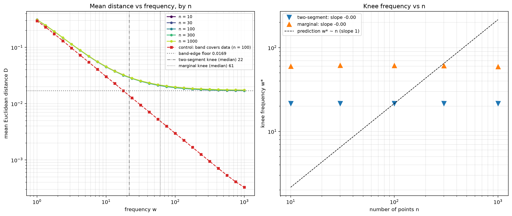

# Resolution of the Squiggly Line Conjecture

**Status: settled. The geometry is true, the parameter claim is false for width, and the learning claim is false.**

*Revised 11 Nov 2026.* The first status line read "the conjecture is true, and
true in a direction that training cannot use". That was too generous: the
conjecture as defined (more parameters, smaller expected nearest-point distance
at initialisation) fails for width. §2 also read the straight-line test too
strongly. Both are corrected in place below, and §7 lists what the review added.

This document supersedes the empirical claims in `docs/history/day-1.md`,
`docs/history/day-2.md`, `docs/history/consolidated.md`, and the paper draft (`main.tex`, since
removed; see git history). The notes are kept as a record of how the idea
developed; they should not be cited for results.

---

## 1. The original claim

> Randomly initialized complex functions sit geometrically closer to random data
> points than simple ones, purely through increased spatial coverage. A larger
> network therefore begins training already closer to the data, which is why it
> learns faster.

Two separable parts: a **geometric claim** about curves and points, and a
**learning claim** that the geometry explains faster training.

---

## 2. The geometric claim is correct — and length alone does not explain it

Earlier experiments varied squiggliness by raising polynomial degree or network
width. That confounds oscillation frequency with output amplitude and with arc
length, so it cannot say which one is doing the work.

`scripts/frequency_isolation.py` separates them. Curves are sines with amplitude
fixed at the standard deviation of the data and random phase, so the marginal
distribution of `f(x)` at any given `x` is *identical* across every row. Frequency
is the only variable.

| frequency | arc length | Euclidean min-distance | vertical residual |
|---|---|---|---|
| 0.25 | 2.19 | 0.6129 | 0.6672 |
| 1 | 3.96 | 0.3095 | 0.6649 |
| 4 | 13.32 | 0.0928 | 0.6663 |
| 16 | 52.31 | 0.0338 | 0.6665 |
| 64 | 208.92 | 0.0207 | 0.6688 |

Euclidean distance falls by a factor of 30. The effect is real, it is large, and
it is not an artifact of amplitude. **The squiggly curve is genuinely closer to
the data.**

The fishing-line picture — more length, more chances to pass near a fish — is
incomplete. Stretch a *straight line* to exactly the arc length of each wiggly
curve and it does not reproduce the effect:

| frequency | arc length | wiggly | straight, same length |
|---|---|---|---|
| 4 | 13.32 | 0.0928 | 0.5022 |
| 16 | 52.31 | 0.0338 | 0.5007 |
| 64 | 208.92 | 0.0207 | 0.5006 |

At 209 units of arc length the straight line is 24× worse. Read this with care.
That line has slope ≈104 over `x ∈ [−1, 1]`, so about 99% of it lies above or
below the data. The test shows that length outside the data region is worth
nothing. It does not show that length is irrelevant. By the tube identity (§7),
a curve of length `l` inside a region of area `V` has mean distance at least
about `V/(4l)`, with equality only when it is **spread evenly**. Length inside
the region is necessary. Spread decides how much that length buys.

This changes the reading of Hanin, Jeong & Rolnick (ICLR 2022), who show that
deep ReLU networks preserve expected curve length at initialization. An earlier
version of this section said their result does not undercut the conjecture
"because length was never the operative variable". With the bound above it does
undercut the parameter claim: a random network whose curve does not get longer
cannot get much closer.

*Numerical correction (19 Sep 2026).* The first version of these tables sampled
every curve on a fixed 4000-point grid. At frequency 64 the sine's steepest
slope is ≈164, so consecutive samples sat ≈0.08 apart vertically — larger than
the distances being measured — and Euclidean distance was overestimated from
frequency ≈32 upward (0.0279 reported at 64, 0.0207 true). The tables above use
`scripts/curves.py`, which sizes the grid per frequency and refines by segment
projection; it agrees with a 10×-finer brute-force reference to 0.1% at
frequency 1000. The straight-line column is now computed exactly. Every
conclusion stands and the effect is larger than first reported, but the
apparent plateau from frequency 32 onward was an artifact — see §5 and §6.

*Second numerical correction (11 Nov 2026).* The 0.1% agreement above holds
only at the default amplitude, where the band-edge floor dominates the mean.
`curves.py` refined the nearest-sample distance on the two segments next to the
nearest sample. Once the gap between neighbouring strokes of the sine (`1/w`)
drops below the sample spacing (0.002), the nearest sample can sit on the wrong
stroke. In the band-covers-data control of §6 this overestimated the mean
distance by 11% at `w = 1000` (0.000324 against 0.000292 on a fixed test set).
`euclid_distance` now projects onto every segment that can contain the nearest
point and is exact for the polyline; it matches an independent brute-force
reference to better than 1e-6 at every frequency from 0.25 to 1000, at both
amplitudes. The tables in this section are unchanged to the digits shown. The
tail fits in §6 moved slightly and are updated there.

## 3. The learning claim is false

The same table already contains the refutation. The **vertical residual** — the
quantity a regression loss actually charges you — is flat: every value lies
between 0.6649 and 0.6688 across a 100× change in arc length. A 0.6% spread,
no trend.

The reason is simple. At every `x`, `f(x)` has the same marginal distribution no
matter how squiggly the curve is. Wiggles let the curve pass near a point that is
**horizontally displaced** from it. Euclidean distance rewards that; mean squared
error gives nothing for being near in `x` and charges the full vertical gap.

The squiggly line is closer to the data in a direction the loss does not
measure at the start.

*Correction (11 Nov 2026).* This sentence first ended "in a direction gradient
descent does not measure", which was too strong. The nearness can be used: a
shift of the input no larger than the nearest-point scale makes the curve pass
through a point, and a small warp of the input fits any target
(`docs/theorem/phase-matching.md`). What is false is that the nearness is a lower loss
before anything moves.

Direct confirmation on the object of interest — random ReLU networks, 10 inputs,
200 random points, initial MSE before any training:

| width | 4 | 16 | 64 | 256 | 1024 |
|---|---|---|---|---|---|
| He init | 2.97 | 2.98 | 3.00 | 3.13 | 2.99 |
| unscaled | 20 | 83 | 312 | 1348 | 4884 |

(The script that produced this table was not kept. `scripts/initial_mse.py`,
added 11 Nov 2026, repeats the comparison with a stated setup and checks it
against the closed form `E[y²] + E[f(x)²]`; its absolute numbers differ because
its data and layer counts are its own.)

Flat under standard initialization. Under unscaled initialization width makes
initial loss dramatically *worse*, which is the amplitude confound that inflated
several of the early polynomial results (fixed coefficient range lets a degree-8
polynomial swing much wider than a degree-2 one).

## 4. Defects in the original measurement code

Run `scripts/audit_legacy_metrics.py` to reproduce all three.

**The core metric was not a distance.** `utils.measure_coverage`, used by
`coverage_measure.py` and `more_effects.py`, computes `abs(yi - np.sum(pattern))`
where `pattern` is the boolean activation vector. `np.sum(pattern)` is the *count
of active neurons*, roughly width/2. Measured output: 4.9 at width 10 rising to
80.1 at width 160. It increases linearly with width — the opposite of the
conjecture — while being captioned as support for it.

**The α ≈ 0.42 power law is signal attenuation.** `relu_chain.py` measures
`||net(x) - x||`, the distance from the network's output to its own input. With
Xavier init on a `2 -> w -> w -> 2` ReLU stack the input layer has `fan_in=2,
fan_out=w`, so weight variance scales as `2/(2+w)` and the output decays toward
zero as width grows. The metric therefore converges to `||x||` — the score of a
network that returns nothing. Measured: 1.3186 at width 2, 1.2325 at width 128,
against a zero-function baseline of 1.2299. The headline scaling law is the
network progressively going silent.

**The 1-D branch measured against a diagonal.** In `relu_chain.py`:

```python
dists = torch.sqrt((x_curve - point[0])**2 + (y_curve - point[0])**2)
```

`point[0]` supplies both coordinates, placing every "random point" on the line
`y = x`. The in-line comment flags it as a simplification; it is a bug.

## 5. What survives

A correct and modestly pretty result about random curves:

> For a curve of fixed amplitude and random phase on a bounded domain, expected
> minimum Euclidean distance to a random point falls with oscillation frequency
> as `D(w) ≈ D∞ + c/w`, saturating at a floor `D∞` set by amplitude: points
> outside the band the curve sweeps can never be reached. The floor and the knee
> do not depend on how many points there are. Arc length inside the data region
> is necessary and not sufficient; how evenly it is spread decides the rest.

For the amplitude used here the band is `|y| ≤ 0.816` and the floor is
`(1 − 0.816)²/2 = 0.0169`. The original write-up anticipated saturation from the
curve "wasting its length by looping back on itself". That is not what happens.
The curve keeps closing in on every point inside its band at rate `1/w`, and
what remains is the fixed cost of the points outside it (§6).

What does not survive is the bridge to learning. The metric that makes the
theorem true is not the metric that training minimizes.

## 6. Open threads, if anyone wants them

- **Saturation scaling — tested, prediction rejected.** The claim was that
  saturation sets in once the wavelength `2/w` drops below the mean inter-point
  spacing `2/n`, so the knee should sit at `w* ∝ n` (slope 1.0 of `log w*` on
  `log n`). `scripts/saturation_scaling.py` sweeps `n ∈ {10, 30, 100, 300, 1000}`
  × 25 frequencies in `[1, 1000]`, 30 000 points per `n`, and locates the knee
  with two criteria fixed in advance and applied identically to every curve:

  | criterion | n=10 | 30 | 100 | 300 | 1000 | slope | 95% CI |
  |---|---|---|---|---|---|---|---|
  | two-segment log-log fit | 21.6 | 21.6 | 21.6 | 21.6 | 21.6 | −0.000 | [−0.004, 0.004] |
  | doubling gains < 10% | 60.1 | 61.7 | 61.4 | 61.0 | 59.4 | −0.003 | [−0.014, 0.008] |

  **Slope 0, not 1.** The knee does not move across two decades of `n`, and the
  five `D(w)` curves agree to within 3.1% at every frequency. The data rule this
  out, and so does the metric's definition: the metric is a mean of per-point
  distances, so its expectation cannot depend on `n` at all. Inter-point
  spacing never enters.

  What sets the knee is the band edge. Fitting `D − D∞ = c·w^(−β)` for `w ≥ 20`
  gives `β = 0.990` and `c = 0.248`. For `D = D∞ + c/w` the 10%-per-doubling
  knee is `c(1−2r)/(2r·D∞) = 58.6`, against 59–62 measured. As a control,
  widening the band to cover the data (`A√2 = 1`, so `D∞ = 0`) removes the
  saturation entirely. Distance falls as `0.301·w^(−1.002)` all the way to
  `w = 1000`, reaching 0.00030, and the 10% criterion never triggers. (The
  two-segment fit still reports a breakpoint, at 1.8, because it always
  returns one. The marginal criterion is the one that can say "no knee".)

  The control has a closed form. At high frequency the strokes are nearly
  vertical, and at height `y` they cross at two interleaved lattices of period
  `2/w`. Averaging the distance to the nearest crossing over `y` gives
  `D·w → (2 − 8/π²)/4 = 0.2974`. A direct measurement gives `D·w = 0.2965` at
  `w = 256`. Arc length tends to `4w`, so `D × length → 2 − 8/π² = 1.19`,
  not the 1.0 of an evenly spread curve.

  (Numbers in the last two paragraphs are from the 11 Nov 2026 re-run with the
  exact distance routine. Before it the fits read `β = 0.978`, `c = 0.236`,
  knee 55.7, and `0.285·w^(−0.989)` reaching 0.00033 for the control.)

  The "knee at `w ≈ 32` for `n = 30`" that suggested this test was the
  grid-resolution artifact described in §2.

  The saturation story needs the correction made in §5: amplitude against data
  range, not point spacing. The `d`-dimensional extension (`w* ∝ n^(1/d)`) was
  conditional on the 1-D result holding, so it was not run.

  
- Does the coverage result say anything about *reachability* — how far parameters
  must travel from initialization — rather than initial loss? That is a different
  and still-open question, and closer to what the lottery-ticket literature is
  actually about.
- The quantum appendix (`scripts/quantum.py`, `docs/history/day-2-quantum.md`) is
  probably circular: for a 1-D box `E ∝ n²`, so `nodes ∝ √E` follows from the
  spectrum by change of variables, and "coverage ∝ √E" follows from that. Worth
  checking before it is repeated anywhere.

## 7. What the review of 11 Nov 2026 added

The conjecture is three claims in a chain: (G) a squigglier curve has a smaller
nearest-point distance; (P) more parameters give a squigglier random function;
(L) a smaller nearest-point distance means a smaller training loss at the
start. G is true. P is false for width and weak for depth. L is false.

- **Slope sandwich.** For a `K`-Lipschitz `f`, at every data point,
  `vertical / √(1 + K²) ≤ nearest ≤ vertical`. The curve can be much nearer
  than its vertical error only if it is steep.
- **Marginal lemma.** The expected loss of a random function depends only on
  the distribution of `f(x)` at each single `x`. So the flat vertical column of
  §2 is forced by the design, and its spread is sampling noise. For networks
  under He initialisation `E[f(x)²]` is the same at every width, so the
  expected initial MSE is `E[y²] + E[f(x)²]` at every width (§3).
- **Tube identity.** `E[dist(P, S)] = ∫₀^∞ P(P is outside the tube of radius r) dr`.
  It replaces the earlier estimate `(uncovered fraction)^(1/d)`, which had no derivation,
  and gives the `V/(4l)` lower bound used in §2.
- **A limit of the test family.** A random-phase sine has one degree of
  freedom and can never fit more than two points at once. The mean per-point
  distance cannot see this, which is why `n` dropped out in §6.
- **Claim G, proved for sines.** If `f` takes every label in range within
  distance `ρ` of every input, then `nearest ≤ ρ`. A sine of frequency `w` does
  so within `π/w`. With the sandwich: `vertical / √(1 + (A·w)²) ≤ nearest ≤ π/w`
  at every data point and phase. So the expected nearest-point distance tends
  to zero as the frequency grows while every regression loss stays fixed.
- **What the conjecture reduces to.** The nearest-point distance is controlled
  from above by the oscillation scale `ρ` of the function and from below by
  the slope. A shrinking `ρ` is sufficient for the conjecture and a growing
  slope is necessary. For random networks, how `ρ` depends on size is open.
- **Formalisation.** `lean/` states the conjecture and the learning claim and
  proves the sandwich, the tube identity, the marginal lemma, the covering
  bound, the two-sided bound for sines, and that the learning claim fails for
  random-phase sines. Not formalised: the constant 0.2974, the `V/(4l)` bound,
  and anything about network width.

---

*Experiments: `scripts/frequency_isolation.py` (≈10 s),
`scripts/saturation_scaling.py` (≈4 min), `scripts/audit_legacy_metrics.py`.
The first two share `scripts/curves.py` and need numpy + scipy.*
