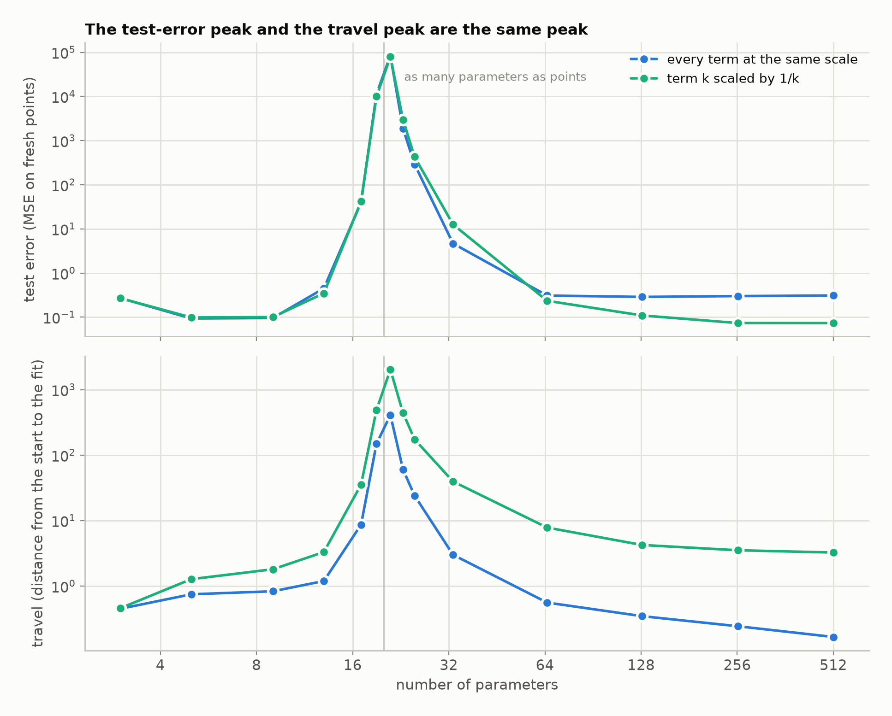

# Double descent, as the travel peak

**Proofs:** [`DoubleDescent.lean`](../../lean/SquigglyLine/Networks/DoubleDescent.lean), [`LinearModel.lean`](../../lean/SquigglyLine/Networks/LinearModel.lean).

Notes from 11 Nov 2026. The original idea claimed that the squiggly line picture
ties in with double descent, and derived nothing. This note is what can
actually be said. Each statement is marked **proved** (in `lean/`),
**measured** (by `scripts/double_descent.py`), or **open**.

## What double descent is

Fit a model to noisy data and score it on fresh data, for models of growing
size. The test error falls, then rises to a peak, then falls again. The peak
sits where the model has just enough parameters to fit every training point.

## The experiment

The same Fourier model as before, now fitted and tested: 20 noisy training
points from a smooth target, 300 data sets per model size.

- With fewer parameters than points no exact fit exists, so the model is
  fitted by least squares.
- With more, the fit is the one nearest to the start. That is the fit
  gradient descent reaches. The start is zero.

| parameters | test error | travel |
|---|---|---|
| 5 | 0.094 | 0.75 |
| 13 | 0.45 | 1.2 |
| 19 | 11,400 | 149 |
| **21** | **83,800** | **409** |
| 25 | 291 | 24 |
| 33 | 4.7 | 3.0 |
| 65 | 0.31 | 0.56 |
| 513 | 0.31 | 0.17 |

(**measured**; medians.) The test error falls to 0.094, climbs to 83,800 at 21
parameters, and falls back. That is double descent. The travel climbs and
falls with it and peaks at the same place.



## Why the two peaks are one peak

Two short facts connect them.

**A fit that is near the start stays near it everywhere.** The fitted function
at any new input differs from the starting function by at most the size of
the features at that input, times the travel (**proved**:
`exists_fit_near_start`). So a small travel means a tame function between the
data points. A large travel is the only way the function can go wild.

**The travel is large exactly when the kernel has a weak direction.** If the
kernel is at least `c` in every direction, the travel is at most the size of
the labels divided by `√c` (**proved**: `travel_le_of_le_kernel`). At the
threshold the model has just enough features to reach every label, and some
direction is reachable only barely. There `c` is tiny: 0.00000007 at 21
parameters, against 202 at 513 (**measured**).

Put together: at the threshold some combination of labels can only be reached
by enormous coefficients. The noise in the labels has a part in that
direction, the fit obeys it, and the function swings wildly between the
points. With more parameters every direction becomes easy, the travel
shrinks, and the function calms down.

So the second descent is the same fact as "a bigger model starts nearer to a
fit". The peak is the one place where the fit is furthest away.

## The peak itself, exactly

The two facts above are bounds. The peak can be stated exactly by following
one direction.

Think of the labels as a list of numbers, one per training point. Pick one
pattern in that list: for instance "up, down, up, down". Call it a direction.
The model's features are either able to produce that pattern or not, and if
they are, they do it with some strength. Call the strength `λ`. Formally `λ`
is how much the kernel stretches that direction.

There are three cases, and they are the three parts of the curve.

1. **Strength zero: out of reach.** No setting of the parameters produces the
   pattern. The model cannot fit that part of the labels, so it leaves it
   alone. Whatever noise lies in that direction does no harm
   (**proved**: `not_exists_fit_of_kernel_eq_zero`).

2. **Strength small: reachable, at a huge price.** Now a fit exists, and the
   model takes it. The distance to that fit is exactly

   ```
   travel = (size of the pattern in the labels) / sqrt(λ)
   ```

   and the fitted function's output at any new input moves by exactly

   ```
   shift = (overlap of the new input with the pattern) / λ
   ```

   The first formula is **proved** (`travel_eq_of_eigen`), and so is the
   blow-up: a strength of at most `ε²` forces a travel of at least the size of
   the pattern divided by `ε` (`le_travel_of_eigen_le`). The second formula is
   a calculation, not yet in Lean. As `λ` goes to zero both grow without
   bound. This is the peak. The model has just become able to fit a pattern, the pattern is
   mostly noise, and fitting it costs coefficients so large that the function
   is thrown far off everywhere else.

3. **Strength large: cheap.** The same two formulas now give small numbers.
   This is the second descent.

Adding parameters only ever adds strength. A direction starts out of reach,
becomes barely reachable, then easily reachable. Past the threshold, adding
parameters never moves the fit further away (**proved** earlier:
`travel_coprod_le`).

So double descent is one direction crossing from "cannot" through "barely
can" to "easily can". Being unable to fit noise is safe. Being barely able to
is the worst case. Being easily able to is safe again.

### The smallest example

One training point and one parameter. The model's output is `a × θ`, where `a`
is the feature. To fit the label `y` the parameter must be `y / a`.

- `a = 0`: no fit. The model ignores the label.
- `a` small: the fit is `y / a`, enormous. At a new input with feature `b` the
  output is `b × y / a`, also enormous.
- `a` large: the fit is small.

With more parameters the feature becomes a list `(a₁, a₂, …)`, the strength is
`a₁² + a₂² + …`, and it can only grow as terms are added (**proved**:
`tightFeatures_innerSL`; the travel is then the error divided by the length of
the feature list, `travel_one_point`).

## How low the second descent goes

It depends on which terms are cheap.

| features | best error before the peak | error at 513 parameters |
|---|---|---|
| every term at the same scale | 0.094 | 0.31 |
| term `k` scaled by `1/k` | 0.099 | 0.073 |

(**measured**.) With every term equally cheap, the fit far past the threshold
is spiky: it hits each training point and returns to zero in between. Its
error, 0.31, is that of predicting zero everywhere, which is 0.32. With high
frequencies made expensive, the nearest fit is a smooth one, and the second
descent ends below the first. The model must be large, and its cheap
directions must be the right ones.

This is the earlier remark about flat and decaying spectra, now with test
error attached.

## What this does and does not show

- It is shown for one model, linear in its parameters, on one target.
- The two proved facts are inequalities. They explain why a small travel
  keeps the function tame. They do not prove that the test error must peak at
  the threshold. That is **measured**.
- Nothing here is new. Double descent in models of this kind is well studied.
  What this adds is the link to the distance we had already been measuring.
- For networks trained in every layer the kernel moves during training, and
  none of this applies as stated. That is **open**.
