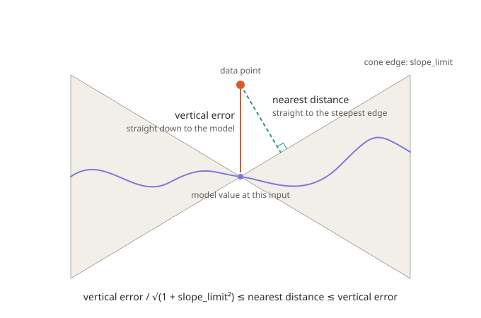

# Proposal 20261114: cross-check and publish Part I, then the clarity fixes

Status: the Part I work in section A is written and uncommitted. It needs only
a cross-check and then publishing. Sections 1 to 8 are older items collected
while reading chapters 02 and 41. None of them is applied, and none of them is
part of this publish.

## A. Part I experiments and diagrams: cross-check, then publish

What exists now (all uncommitted):

- `experiments/part1/`: one Jupyter notebook per chapter of Part I (1, 3, 4, 5, 6
  and 7; chapter 2 is about reading Lean and has nothing to measure), in PyTorch.
  Each notebook explains the claim it checks, runs the experiment, asserts the
  result, and draws its own figures with seaborn's default theme and `deep`
  palette. Chapter 6's notebook also
  trains the sine model by SGD. `common.py` holds the shared helpers (the sine
  model, the nearest-distance measure, the figure style). A check that fails stops
  the notebook, so a notebook that runs to the end has passed.
- `book/figures/`: 14 new figures for chapters 1, 3, 4, 5, 6 and 7, including
  five before and after, with and without bar charts. `nearest-distance-bounds.svg`
  is the older hand-drawn diagram and is not used by any chapter.
- Chapter 1 and the glossary now explain the **warp** (a way to move each input
  a little so the model read at the moved input equals the target), with a
  worked example. It first appeared in chapter 4, with no earlier introduction.
- Chapters 1, 3, 4, 5, 6 and 7 each gained their figures and a "Run it
  yourself" section with the measured numbers. Chapter 6 also gained a section,
  "A model that learns".
- `book/html/build.sh` now copies `figures/` images into the web build.

The cross-check, one pass, by someone who did not write the scripts:

1. Run every notebook from a clean state, twice:
   `jupyter nbconvert --to notebook --execute --inplace experiments/part1/ch*.ipynb`.
   Every notebook must finish, and the printed `[PASS]` lines must be identical in
   the two runs (every notebook is seeded).
2. For each chapter, compare every number in the new text with the output of the
   notebook named in its "Run it yourself" section, and with the figure that
   shows it.
3. Open each figure and check that its title, axis labels and caption agree
   with the numbers in the chapter, and that no label sits on a curve.
4. Read each notebook against the chapter claim it checks: does the check say
   what the chapter says, and would it fail if the claim were false? (Three of
   my first thresholds were too tight and were changed after a failure; look at
   each of those and confirm the change is honest. They are listed below.)
5. `python book/tools/check_book.py 1 3 4 5 6 7` must end with `problems: 0`.
6. Build the web book and the PDF, and read Part I in both.

Findings the reader should look at first:

- Chapter 5 says untrained networks of five widths start with the same error.
  In PyTorch's default initialisation they differ at small width (0.50 at width
  4, 0.41 at width 1024) because the last-layer bias adds `1 / (3 × width)`.
  Without that term the widths agree. The chapter now says so. Check this
  against `scripts/initial_mse.py`, which made the original graph.
- Chapter 6's table is reproduced within 0.006 (nearest) and 0.002 (vertical).
- A first draft of chapter 7's reach check used a clamped signed denominator
  and gave reaches near 14; that was a bug in the script, fixed, not a
  finding about the theorem.
- In chapter 6's notebook, one of five runs with 2 terms did not reach loss
  0.05 in 4000 steps. It is plotted at 4000 and mentioned in chapter 6. The
  speed result (fewer steps for larger models) is clear only from 32 terms up,
  and rests on 5 seeds of one learning rate. It is labelled measured.
- Thresholds changed after a failed run: the flat versus jagged spread (the
  claim holds with 100 data points, not 4), the chapter 5 width check (adjusted
  for the last-layer bias), the chapter 6 vertical error range (200,000
  samples instead of 500), and the starting loss in the training section
  (300 draws against the exact expectation instead of 5 runs).

Complaints about chapter 5, which claims too much. These are for the reader to
judge, and none is fixed except the first:

1. **"Untrained networks of five widths start with the same error."** They do
   not, quite. With PyTorch's default initialisation the mean is 0.50 at width 4
   and 0.41 at width 1024, a 21% spread. It is level only after taking out the
   last-layer bias, which adds `1 / (3 × width)`. The chapter now says so, but
   the sentence before it still reads as if the widths were equal.
2. **"It also explains a measurement."** The marginal lemma needs the one-point
   marginals to be equal. For a real network of each width the book proves no
   such thing, so the lemma is consistent with the measurement but does not
   explain it. "Explains" should be "is consistent with", or the book should say
   what would have to be true of the initialisation.
3. **"Standard initialisation is designed to keep the size of the output the
   same at every width."** That is true of the weights. It is not true of the
   biases, as item 1 shows, so the sentence needs "of the weights".
4. **The lemma is about the average, not one network.** The loss at the start
   differs from draw to draw. With 100 data points, the flat model's loss has a
   spread of 0.30 and the jagged one's 0.07, around the same average. The
   chapter says "the same average loss" in some places and "start with the same
   error" in others. Say "on average over the draw" every time.
5. **Chapter 1 marks claim 3 "False. Chapter 5."** The lemma disproves it for
   losses that read one input at a time and for the loss averaged over the
   random start. A loss that reads two inputs at once, for example a smoothness
   penalty, can see the squiggle. Chapter 5 says so under "What is not shown",
   but chapter 1 and chapter 6's "closer but no better" do not.
6. **One data set.** The width measurement uses one-dimensional inputs and
   uniform labels. The original graph came from `scripts/initial_mse.py`, which
   I have not compared line by line.

A caution about the sine model as a stand-in for deep networks. In the sine
model, the width is the number of terms and the depth is one hidden layer (the
frequencies and phases, then the amplitudes). Adding terms adds higher
frequencies, so a wider sine model is squigglier by construction. In ReLU
networks, chapter 8 says width does not buy squiggle the way depth does. So
"more parameters give a squigglier curve" is built into the sine model and is
no evidence about random-weight networks (the open half of claim 2). The
experiments here test width in a Fourier basis. They do not test depth. A deeper
sine model, `sin(a × sin(x) + b)`, would compose frequencies and could be added.
Chapter 6 should define width and depth for the sine model in one sentence.

Publishing, once the cross-check is done:

1. Commit the experiments, figures, chapters and `build.sh` change to `main`
   and push.
2. The web version and the PDF are built only for a tag starting with `v`
   (`.github/workflows/book.yml`). Tagging is public, so the reader picks the
   version number before anything is tagged.
3. Check the tag's build: the GitHub Pages site shows the new figures, and the
   release PDF has them.

Not in this publish: the renames, the `ℤ` row, the Lipschitz notes and the
project-wide theorem renaming below.

## Notation used in this proposal

Three different things, three different names. Keep them apart in the book too.

| Name | What it is | Where it lives |
|---|---|---|
| `slope_limit` | the Lipschitz constant: the steepest the curve may be (the slope scaling constant in `LipschitzWith slope_limit model`). Never written as a bare `K`. | the theorems, the diagram |
| `N` | the number of sine terms: a hyperparameter, the model size. With the phase and amplitude of each term, the model has `2N` learnable parameters. | the experiments |
| `j` | the index of a term, `j = 1 … N`. Term `j` has the fixed integer frequency `j`. | the model formula |

`slope_limit` is computed from the parameters (`slope_limit ≤ Σ_j |a_j| · j`).
It is not a parameter and it is not the model size.

## 1. Rename the counting-theorem pieces

In `lean/SquigglyLine/Supporting/NewInputs/Counting.lean:115-117`, and the same
block in `book/02-reading-a-proof.md:115-117` and `book/41-counting.md:107-109`:

```lean
let count_jump           := (1 : ℝ)
let slope_times_distance := slope_limit * dist input other_input
count_jump ≤ slope_times_distance
```

Both sides are changes in the **output**: the model goes from `count` to
`count + 1`, and the Lipschitz bound caps how far the output may move. The
inputs only appear through `dist input other_input`. So the names should say
"output", not "x" or "y" (the inputs can be 1D, 2D or 3D, so x/y would not fit
anyway). Proposed:

```lean
let output_change     := (1 : ℝ)  -- from `count` to `count + 1`
let max_output_change := slope_limit * dist input other_input
output_change ≤ max_output_change
```

`Temperature.lean:150-152` already has the same shape
(`output_shift ≤ slope_times_distance`). Pick one pair and use it in both
files. Decision for the reader: `output_change` / `max_output_change`, or
`output_shift` / `max_output_shift`.

Also check any other theorem that names `slope_times_distance`
(`grep -rn slope_times_distance lean book`). After renaming, rebuild the Lean
project and the book (PDF and web) to confirm both still build.

## 2. Symbols table in book/02-reading-a-proof.md

The table row `ℝ, ℕ → a real number; a counting number → float, int` is loose:

- Add a `ℤ` row (whole numbers, negatives allowed; Lean `Int`).
- `ℕ` has no negatives and subtraction stops at 0 (`3 - 5 = 0`). Say so once.
- The Python analogy `int` fits `ℤ` better than `ℕ`.
- `ℝ → float` hides that a Lean real is exact, with no rounding. Say so once.

## 3. Reword "Theorem names are older and shorter"

`book/02-reading-a-proof.md:51`. "Older" is ambiguous. Say that theorem names
predate the naming convention in the table above and are kept short, and that
the reader should treat them as labels.

## 4. Explain the Lipschitz line where it first appears

Readers hit `LipschitzWith slope_limit model` and `{Inputs : Type*}
[PseudoMetricSpace Inputs]` with no help. Add a short note at first use:

- Lipschitz: `|f(a) − f(b)| ≤ slope_limit · |a − b|`, the slope never exceeds `slope_limit`.
  Corners are allowed, so it is not the same as differentiable.
- `LipschitzWith slope_limit f` is the Mathlib predicate, `slope_limit` is a non-negative real.
- `Type*` means "a type at any universe level, picked automatically".
- `[PseudoMetricSpace Inputs]` means "`Inputs` has a distance". That is why
  the results hold in 1D, 2D and 3D alike.
- `slope_times_distance` is slope limit times the gap between two inputs
  (rise ≤ slope × run). It is not `f'(x) · x`.

## 5. Add more diagrams across the book

General request: the book needs more diagrams. Rule of thumb, add one wherever
a chapter states an inequality or a geometric fact in words only.

First one to add: the bound

```
vertical_error / √(1 + slope_limit²)  ≤  nearest_distance  ≤  vertical_error
```

Draft already saved: [book/figures/nearest-distance-bounds.svg](book/figures/nearest-distance-bounds.svg)
(light-mode colours, white background, not yet referenced from any chapter).



Diagram content:

- A model curve and a data point above it.
- Vertical segment down to the curve (the vertical error, `v`).
- Dashed perpendicular segment to the steepest allowed line (nearest distance),
  with a right-angle mark.
- Shaded double cone of slope `slope_limit` through the curve point: a curve with that
  slope limit cannot leave it. This gives the lower bound.
- Caption: the inequality above.

Prose to go with it:

- Upper bound: the point straight below the data point is on the curve, so the
  nearest point can only be as close or closer.
- Lower bound: the angle θ between the vertical and the perpendicular has
  `tan θ = slope_limit`, so the perpendicular is `v · cos θ = v / √(1+slope_limit²)`.
- Equality: `slope_limit = 0` makes both ends equal. A steeper `slope_limit` widens the gap.
- The same argument works in any dimension: the cone lives in the input space.

Other candidates to look at while the reader goes through the chapters:

- Counting chapter (41): two inputs whose outputs differ by 1 must be at least
  `1 / slope_limit` apart. Draw a ramp of slope `slope_limit` and the minimum run.
- Temperature chapter: output shift ≤ slope × code distance. Draw two codes,
  the decoder arrow, and the two outputs.
- Chapter 02: a picture of the three givens and the goal of a theorem, mapped
  onto the Lean statement.
- Chapter on regression loss: the vertical (output-axis) residual versus the
  perpendicular distance, and why the loss's error signal is vertical.

Process note: each new diagram should be an SVG file in `book/` with a short
caption, and must render in both the PDF build and the GitHub Pages build.

## 6. Experimental backing for the proofs, using a Fourier sine model

Every proof in the book should have a small experiment that checks it
numerically. Real neural networks are too expensive to train for this, so use a
cheap stand-in: a Fourier series sine model

```
f(x) = Σ_j a_j · sin(j · x + φ_j),   j = 1 … N
```

Why this model fits:

- It is a "squiggly line" with an exact slope limit that can be read off its
  parameters: `slope_limit ≤ Σ_j |a_j| · j` (term `j` has slope at most `|a_j| · j`),
  so the `LipschitzWith slope_limit model` hypothesis is computed, not
  estimated. The amplitudes change during training, so recompute it from the
  current parameters each time it is checked.
- It is trainable like a real network. The number of terms `N` is the
  hyperparameter (the model size). Term `j` has a fixed integer frequency `j`
  and two learnable parameters, the amplitude `a_j` and the phase `φ_j`, so the
  model has `2N` learnable parameters. It trains with ordinary SGD, so the full
  loop is testable: initialise, train, check the bound before, during and
  after. Training in `(a_j, φ_j)` is non-linear even though the function class
  is the plain Fourier series, so note which parametrization the experiments
  use.
- It is cheap: a few dozen parameters, evaluated on a grid. Thousands of random
  initialisations, data sets and training runs take seconds, where real
  networks would take hours.
- Random initial parameters give many different squiggles, and a few
  hand-picked ones (large `N`, high frequency, steep `slope_limit`) are the adversarial
  cases.
- It is the model the main theorem already uses
  (`lean/SquigglyLine/Theorem/SquigglyLineTheorem.lean`): a sine curve whose
  frequency can be raised. So the experiments back exactly what the theorem
  states.

Why it is a good proxy for bigger models: the sine model is expected to show
the same puzzling behaviours that large deep networks show. Two to test and
record, not to assume:

- Faster training with more parameters: sweep the number of terms `N` and
  measure steps of SGD to reach a fixed training loss. Expect the larger models
  to get there sooner.
- Double descent: sweep `N` from well below the number of data points to well
  above it, with noisy labels and a held-out test set, and plot test error
  against `N`. Expect the test error to rise near the point where `N` matches
  the data size, then fall again beyond it. Random Fourier feature models are
  known to show this, so the result is established for this model family, but
  the experiment here should reproduce it with this repo's own setup.

If both show up, the book can say once, with the plots, that every other
experiment on this model carries over in spirit to larger networks. Label it
**measured**, as chapter 5 does, never proved. If one does not show up, say that
too, and narrow the claim to what did.

What to check, one experiment per proof:

- Nearest-distance bounds: for random models and data points, compute the
  vertical error and the true nearest distance (dense sampling of the curve, or
  a root solve). Confirm
  `vertical / √(1 + slope_limit²) ≤ nearest ≤ vertical` always holds, and plot how close
  each end gets, as a function of `slope_limit`.
- Claim 3 (initial loss equal at every frequency): initialise many models at
  several frequencies and confirm the average starting loss is the same.
  Then train each with SGD and record how the loss, the nearest distance and
  `slope_limit` change. This shows the effect claim 3 explains: a curve can get nearer
  to the data (higher frequency) without its loss moving at the start.
- Counting: build a model whose output goes from `count` to `count + 1` and
  confirm the input gap is at least `1 / slope_limit`.
- Temperature / decoder: check `output_shift ≤ slope_limit · code_distance` over random
  code pairs.
- Higher dimensions: a 2D input version using a sum of sines in `(x₁, x₂)`, so
  the "3D" case in the book is backed too.

Deliverables and rules:

- One short script per proof, with a fixed random seed, in an `experiments/`
  folder, each printing the worst case found and whether the bound held.
- A one-line "Experiment" note in the matching book chapter linking to the
  script and the plot, so the reader sees the proof and the numbers side by
  side.
- An experiment is evidence, not a proof. Say so in the chapter text, so no one
  reads "ran 100,000 cases" as a replacement for the Lean proof.
- State the model's limits once: a sum of sines is smooth and periodic, so it
  does not cover models with corners or sharp jumps. Add a small
  piecewise-linear or ReLU-style model for the cases where corners matter.
- Follow the repo's Lean-style naming (snake_case locals, SCREAMING_SNAKE
  globals, verb-like function names) in the Python scripts too.

Open question for the reader: which language for the scripts (Python with
NumPy is the default, since it is the cheapest to run and read).

## 7. Theorem names that read as English (project-wide refactor)

Problem: a theorem name like `verticalDist_le_of_lipschitz` is Mathlib shorthand,
not English. `le` means "less than or equal", `of` means "if", and it names a
mathematician. Read out loud it says nothing. A name should say what the theorem
claims, in the repo's own words.

The same problem shows in the shape of the names. `nearestDist_le_verticalDist`
is half camelCase and half snake_case: `nearestDist` and `verticalDist` are
camelCase, `le` is a Mathlib abbreviation, and the underscores are snake_case.
The definitions were already renamed to `GET_NEAREST_DISTANCE` and
`GET_VERTICAL_ERROR` (see `lean/RENAMES.txt`), so the theorem names still use the
words the definitions dropped. Every theorem name should be plain snake_case in
the repo's vocabulary: `nearestDist_le_verticalDist` becomes
`nearest_distance_is_at_most_vertical_error`. This is strange to leave as it is,
and it is part of the project-wide refactor below.

The theorem in plain English: if the model's slope is never more than the slope
limit, then the vertical error is at most the stretch factor times the nearest
distance, where the stretch factor is `√(1 + slope_limit²)`.

Sample (chosen by the reader):

```lean
theorem vertical_error_is_at_most_slope_budget
    {slope_limit : SlopeLimit}
    (slope_is_bounded : LipschitzWith slope_limit model)
    (data_point : DataPoint Inputs) :
    let vertical_error   := GET_VERTICAL_ERROR model data_point
    let nearest_distance := GET_NEAREST_DISTANCE model data_point
    let slope_budget     := √(1 + (slope_limit : ℝ) ^ 2) * nearest_distance
    vertical_error ≤ slope_budget
```

`slope_budget` is a proper noun for "the nearest distance, stretched by
`√(1 + slope_limit²)`": the most vertical error the slope allows, given how near
the curve is. Define it once in the book (and as `GET_SLOPE_BUDGET slope_limit
nearest_distance` in Lean if it is reused), so the name carries the meaning
inside the project. It is the quantity the repo's notes already call the "slope
tax" (`Oscillation.lean:27`); settle on one word, `slope_budget`, and use it in
those notes too.

Reading the name: "the vertical error is at most the slope budget". The
condition "if the slope is bounded" is the first hypothesis, directly under the
name, so the name does not repeat it. `LipschitzWith` stays in the statement
because it is Mathlib's name, and the theorem's own name has no surname in it.

The sibling theorem `verticalDist_le_of_lipschitz_of_coversWithin` (the slope
tax with a covering bound) gets a name in the same style, for example
`vertical_error_is_at_most_slope_budget_for_covering_curve`. Final wording to be
settled when the rename table is written.

Rules for the new names:

- A sentence in `snake_case` that reads in plain English.
- "is at most", "is at least", "equals", "is positive" in place of `le`, `ge`,
  `eq`, `pos`. "if" or "when" for a hypothesis, only when the signature does not
  already show it.
- No surnames (Lipschitz and the like) in a name we write.
- The repo's own vocabulary: `vertical_error`, `nearest_distance`,
  `slope_limit`, `output_change` (see item 1).
- Names that come from Mathlib are not changed.

This is a project-wide refactor, not a one-off:

- Size: 543 theorem and lemma declarations in 78 files under
  `lean/SquigglyLine` (a count of lines that start with `theorem` or `lemma`,
  so a declaration with a prefix such as `@[simp]` may be missed; a broader
  count gave 544. The dependency packages are not counted).
- It reverses a current rule. `lean/STYLE.md` says "a theorem: unchanged" in
  the names table and "Theorem names are not changed. Notes, the paper and other
  files refer to them." Update both lines first, and write down the new naming
  rules.
- What refers to theorem names and must change with them: the Lean files, the
  book chapters (for example 03, 04 and 41), `docs/wishlist.md`, the notes, and
  the paper draft. The paper draft lives only on the internal `paper-draft`
  branch, so handle it there and never push it to the public remote.

Steps:

1. Update `lean/STYLE.md` with the new rules.
2. Generate a table of every old name and its proposed new name. The reader
   reviews it before anything is applied. Keep the table in the repo, next to
   `lean/RENAMES.txt` (which logs the earlier snake_case and verb renames).
3. Apply the table mechanically: whole-word replacement across `lean/`, `book/`,
   `docs/` and the notes. No hand edits to the mathematics.
4. Rebuild Lean from scratch and check the fingerprints
   (`lean/FINGERPRINT.txt`, `lean/MAIN_FINGERPRINT.txt`). They ignore names, so
   they must not change. Rebuild the book (PDF and web).
5. One commit for the refactor. Optionally keep `@[deprecated]` aliases for the
   old names for one release, in case anything outside the repo uses them.

Helpers: write the naming rules and the table once in a brief on disk, and give
each helper only its file list, as with the porting work.

## 8. Open items (reader to add)

- [ ] (add anything noticed while reading the rest of chapter 02 / 41)
